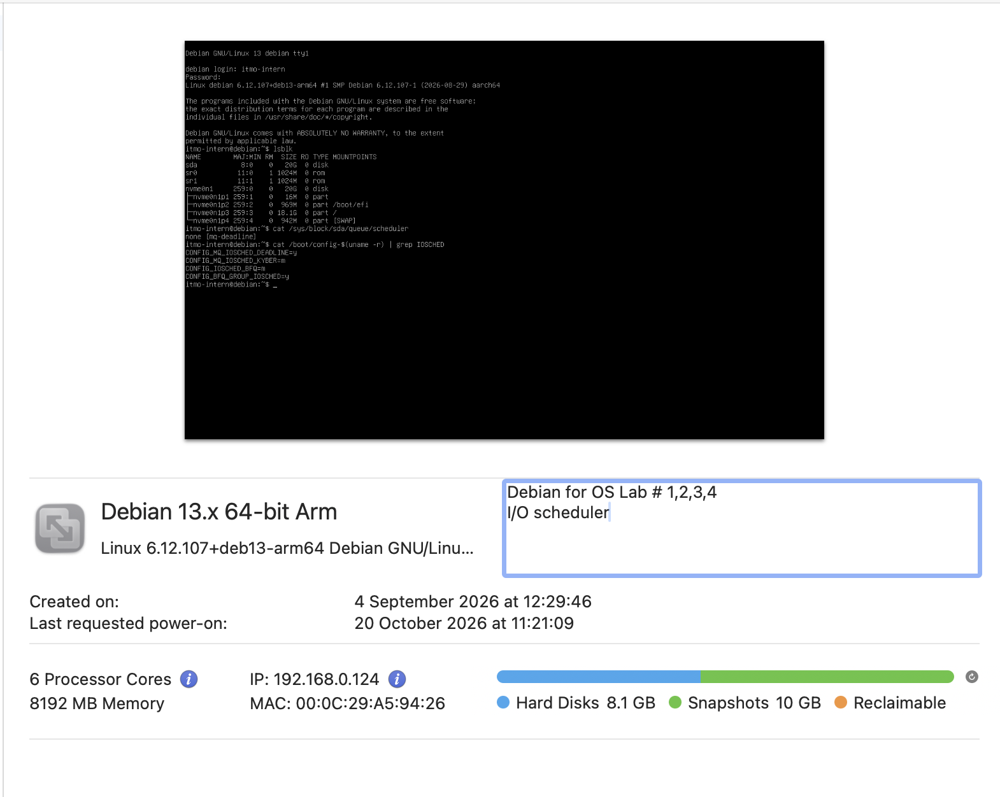
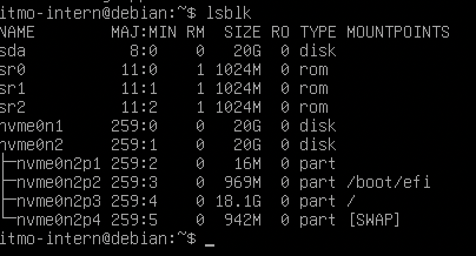
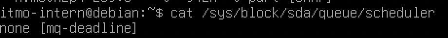
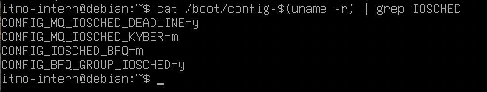
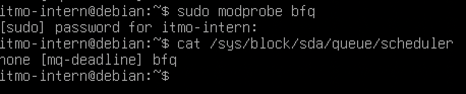
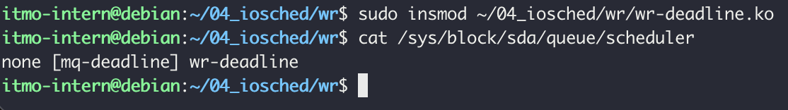
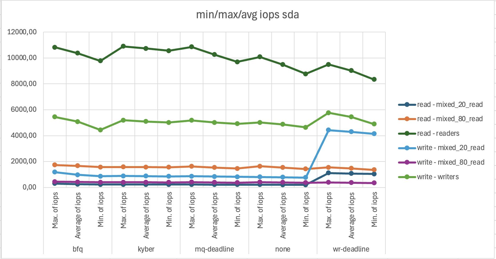
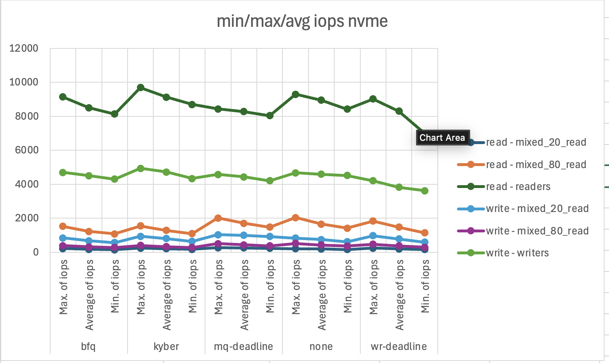
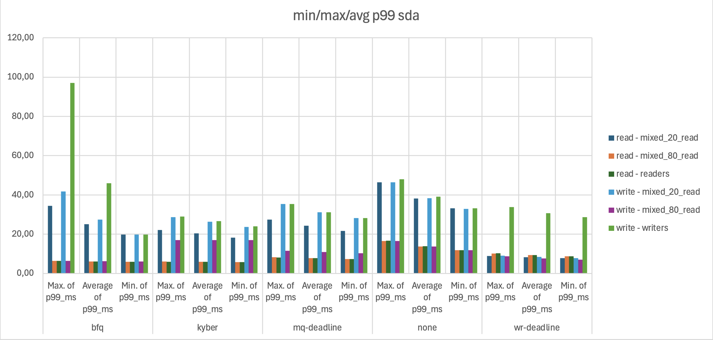
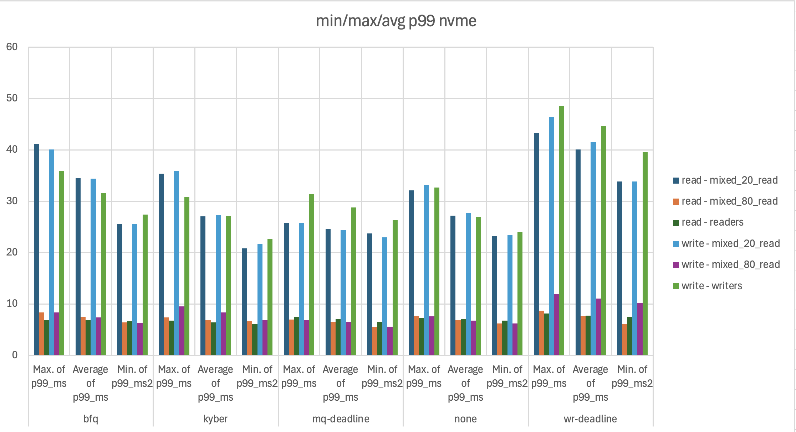

# Вводная часть
## I/O Scheduler: с чем мы имеем дело
Мы уже знаем о существовании планировщика процессов [a-03 Linpack](a-03%20Linpack.md) так зачем же нужен планировщик I/O и зачем он нужен?
В то время как планировщики процессов отвечают за задачу распределения ресурсов процессора между процессами встаёт вопрос: что если процессу нужны данные с диска? а что если нескольким?
Нужно определить приоритет данных и достать их с его учётом. Тут и появляется планировщик устройств ввода/вывода. Его задача оптимальным образом обеспечить доступ процесса к запрашиваемому дисковому устройству. 
Работа с дисками относится к очень медленным операциям, имеющая к тому же долгое время поиска нужной информации, а процессов терпеливо ожидающих своей очереди может быть очень много. Поэтому алгоритм I/O scheduler должен с одной стороны уметь уменьшать время поиска информации на диске, ведь частое
переключение между задачами приведет к тому, что головка диска будет большую часть времени будет просто переходить на разные позиции. Также I/O scheduler должен уметь выдавать информацию в соответствии с приоритетом и гарантировать получение данных приложению за определенное время и в нужном количестве.

## Типы планировщиков (историческая справка)
- [Noop](#Noop)
- [Deadline](#Deadline)
- [Anticipatory](#Anticipatory)
- [CFQ](#CFQ)
- [BFQ](#BFQ)
- [blk-mq](#blk-mq)
---
### Noop
(No Operation)
Наиболее простой планировщик. Он банально помещает все запросы в очередь FIFO и исполняет их вне зависимости от того, пытаются ли приложения читать или писать. Планировщик этот, тем не менее, пытается объединять однотипные запросы для сокращения операций ввода/вывода. Потребляет меньшее кол-во ресурсов.
>[!tip]
Предназначен NOOP в основном для работы с не дисковыми устройствами (ОЗУ или флэшдиск)
### Deadline
Задачей алгоритма Deadline является минимизация задержек ввода/вывода,
и обспечение поведения, близкого к реальному времени. В нем использовано
5 очередей ввода/вывода, а планировщик использует алгоритм предельного
срока для улучшения производительности постоянно переупорядочивая
запросы. Кратко суть алгоритма заключается в том, что операциям чтения
всегда отдается предпочтение перед операциями записи.
Кроме того, запросы объединяются в пакеты. Пакетом называется последовательность запросов на чтение либо на запись, которая идет в сторону больших секторов («алгоритм лифта»). После его обработки планировщик смотрит, есть ли запросы на запись, которые не обслуживались длительное время, и в зависимости от этого решает, создавать ли пакет на чтение либо же на запись.
>[!Note]
>Данный алгоритм больше подходит для систем, в которых количество считываемой информации превосходит количество записываемой, например базы данных или веб-сервер.

>[!Warning]
>Алгоритм лифта:
>Алгоритм заключается в движении головки диска по блинам. По мере движения в одну сторону головка обслуживает все встречающиеся операции ввода-вывода. Далее головка движется в обратном направлении, выполняя то же самое.
### Anticipatory
(упреждающий конвейер)
Основан на Deadline, его алгоритм позволяет минимизировать перемещение головки по диску. Для этого перед запросом вводится некая управляемая задержка, при помощи которой достигается переупорядочение и объединение операций обращения к диску.
### CFQ
(Completely Fair Queuing)
Заключается его алгоритм в следующем. Каждому процессу назначается своя очередь запросов ввода/вывода. Каждой очереди затем присваивается квант времени. Планировщик же циклически обходит все процессы и обслуживает каждый из них, пока не закончится очередь либо не истечет заданный квант времени. Если очередь закончилась раньше, чем истек выделенный для нее квант времени, планировщик подождет (по умолчанию 10 мс) и, в случае напрасного ожидания, перейдет к следующей очереди. Отмечу, что в рамках каждой очереди чтение имеет приоритет над записью.
### BFQ
(Budget Fair Queueing)
Базируется на CFQ. Если не вдаваться в технические подробности, каждой очереди (которая, как и в CFQ, назначается попроцессно) выделяется свой «бюджет», и, если процесс интенсивно работает с диском, данный «бюджет» увеличивается.
### blk-mq
(Multiqueue Block Layer)
Запрос сначала попадает в программную очередь. Количество этих очередей равно количеству ядер процессора. После прохождения программной очереди запрос попадает в очередь отправки. Количество очередей отправки уже зависит от драйвера устройства, который может поддерживать от 1 до 2048 очередей. Так как работа планировщика осуществляется на уровне программных очередей, то запрос из любой программной очереди может попасть в любую очередь отправки, предоставляемую драйвером.
Механизм **blk-mq** был разработан после появления NVMe-дисков, когда стало ясно, что стандартные средства ядра не дают необходимой производительности. Он был добавлен в ядро 3.13, однако планировщики были написаны позже. В новейших версиях ядра Linux (≥4.12) имеются следующие планировщики для blk-mq: none, bfq, mq-deadline и kyber. Рассмотрим каждый из этих планировщиков подробнее.
## blk-mq планировщики
Старые I/O планировщики были заменены их новыми версиями/новыми. Из них
- __none__ — режим, при котором I/O scheduler отключён. - Режим `none` является стандартом де-факто для высокоскоростных NVMe-накопителей. Поскольку современные быстрые SSD имеют тысячи аппаратных очередей и высокую степень параллелизма, классические планировщики создают лишние накладные расходы на процессор и могут снижать скорость работы.
- __bfq__ — реализация bfq с использованием blk-mq.
- __mq-deadline__ — реализация deadline с использованием blk-mq.
- __kyber__ — был написан для работы с быстрыми устройствами. Используя две очереди — запросы на запись и на чтение, kyber отдает приоритет запросам на чтение, перед запросами на запись. Алгоритм измеряет время завершения каждого запроса и корректирует фактический размер очереди для достижения установленных в настройках задержек.

## Параметры mq-deadline (усложнённая часть)
Разберём код планировщика mq-deadline при помощи ии, чтобы понять, какие настройки там есть и что можно поменять.

### Ещё чутка про работу
Планировщик держит для каждого направления (чтение, запись) две структуры: очередь по номеру сектора и очередь по времени прихода (FIFO со сроком). Решает он в два этапа:
1. **Выбор направления** на каждую «пачку»: читать или писать.
2. **Выбор запроса внутри направления**: идти по возрастанию секторов, а если срок у самого старого запроса истёк, начать с него.
>[!Note]
>Про пачки: диск принимает запросы на чтение и запись по одному. Каждый раз, когда диск готов принять запрос, планировщик отдаёт ему один запрос из очереди. Эта очередь и есть пачка -- серия запросов, соответствующая одному типу операции (чтение/запись). Важно: проходя по этой очереди тип операции не меняется!
>Т.е чем меньше пачка, тем быстрее сменяет чтение за запись и наоборот.

>[!Note]
>Срок влияет только на выбор запроса внутри направления, на выбор самого направления нет.

### Рассмотрим несколько параметров планировщика
| Параметр            | По умолчанию        | За что отвечает                                                                              |
| ------------------- | ------------------- | -------------------------------------------------------------------------------------------- |
| `read_expire`       | 500 мс              | Срок «мягкого дедлайна» чтения. Задаётся при вставке запроса. В sysfs в миллисекундах        |
| `write_expire`      | 5000 мс             | То же для записи                                                                             |
| `writes_starved`    | 2                   | Сколько пачек чтения подряд можно отдать, пока ждёт запись                                   |
| `fifo_batch`        | 16                  | Размер пачки: сколько запросов подряд идут в одном направлении по порядку секторов           |
| `front_merges`      | 1                   | Разрешить слияние нового запроса с уже стоящим «спереди» (0 или 1)                           |
| `async_depth`       | равен `nr_requests` | Сколько тегов могут занять записи и асинхронные запросы. Синхронное чтение не ограничивается |
| `prio_aging_expire` | 10 с                | Через сколько отдавать запросы низкого класса `ioprio` при наличии высоких                   |


__Цель:__
Изменить параметры `mq-deadline` так, чтобы изменился приоритет с чтения на запись. Для этого изменим константы внутри модуля планировщика (саму логику не меняю, т.к не умею):
Для выполнения цели поменяем сроки чтения и записи (`read_expire` и `write_expire`), количество пачек чтения, которые можно отдать, пока идёт запись (`writes_starved`) и размер пачки (`fifo_batch`). 
Выполним настройку таковой, что в очереди на выполнение всегда будет запись.

Было:
```c
static const int read_expire = HZ / 2;
static const int write_expire = 5 * HZ;


static const int prio_aging_expire = 10 * HZ;
static const int writes_starved = 2; 
static const int fifo_batch = 16; 
```

Стало:
```c
static const int read_expire = 5 * HZ;
static const int write_expire = HZ / 2;


static const int prio_aging_expire = 10 * HZ;
static const int writes_starved = 0; 
static const int fifo_batch = 64; 
```

Изменения:
- `writes_starved = 0` — запись всегда идёт первой, пока она есть в очереди
- `fifo_batch = 64` — размер пачки увеличивается
- `read_expire` и `write_expire` поменялись местами


## Бенчмарк
Для проведения сравнения выбран бенчмарк [fio - Flexible I/O tester](https://www.mankier.com/1/fio#Job_Parameters-Units).
В основе fio лежит идея моделирования реальных сценариев нагрузки с помощью создания множества параллельных потоков или процессов, которые выполняют операции ввода-вывода по заданным правилам.
Тест проверяет напрямую блочное устройство, наличие файловой системы не обязательно (исключается влияние настроек фс на проверку непосредственно диска). 
Для работы программы необходим конфиг с настройками бенчмарка. Разберём параметры, которые будут использоваться при написании конфига:
>[!NOTE]
>__\[global\]__ (общие настройки)
>- ioengine — программный интерфейс, через который fio отправляет запросы. (`sync`, `psync`, `libaio`, `io_uring`, `mmap`, `posixaio` и др.)
>- blocksize — размер блока данных для одной отдельной операции ввода-вывода. ( `512`, `4k`, `64k`, `1m`)
> - direct — прямой доступ к устройству. Определяет, будет ли задействован страничный кэш оперативной памяти. (`1` - вкл/обойти кэш, `0` - выкл/использовать кэш)
>- iodepth — глубина очереди запросов для каждого потока. Определяет, сколько параллельных незавершённых асинхронных операций может одновременно находится в обработку у накопителя. (`1`, `4`, `8`, `32`, `128` и т.д)
>- time_based — работать все `runtime` секунд (`1` - вкл, `0` - выкл)
>- runtime — ограничение теста по времени в секундах. (`30`, `60`, `7200` и т.д)
>- ramp_time — работа бенчмарка в секундах, не входящая в статистику (для прогрева) (`30`, `60`, `7200` и т.д)
>- random_generator — определяет математический алгоритм, по которому генерируется псевдослучайные смещения при случайном доступе. ( `lfsr`, `tausworthe`)
>- group_reporting — сбор статистики по группам процессов (`1` - вкл, `0` - выкл)
>- lat_percentiles — процентили считаются по полной задержке (`1` - вкл, `0` - выкл)
>- percentile_list — какие процентили выводить
>- filename — задаёт объект для тестирования. (`/dev/nvme0n1p1`, `/dev/sda` и т.д)
>- size — размер накопителя
>__\[writers\]__ (Писатели)
>- numjobs — степень параллелизма задачи т.е сколько независимых потоков будет создано для выполнения этой секции. (`1`, `2`, `10`, `64` и т.д)
>- rw — тип доступа к данным. ( `read`, `write`, `randread`, `randwrite`, `rw`, `randrw`, `trim`, `randtrim`)
>- new_group — создание группы
>__\[readers\]__ (Читатели)
>- numjobs — степень параллелизма задачи т.е сколько независимых потоков будет создано для выполнения этой секции. (`1`, `2`, `10`, `64` и т.д)
>- rw — тип доступа к данным. ( `read`, `write`, `randread`, `randwrite`, `rw`, `randrw`, `trim`, `randtrim`)
>- rwmixread — процентное соотношение операций чтения и записи при использовании смешанных паттернов - процент чтения. (от `0` до `100`)
>- new_group — создание группы

# Настройка ВМ + бенчмарка
## ВМ
### Конфигурация
Для теста используется ВМ на Debian, 6 ядер, 8 ГБ оперативной памяти.

Ядро: Linux debian 6.12.107+deb13-arm64 
### Диски
Будет тестироваться 2 виртуальных диска:
- nvme0n1
- sda


### Тестируемые планировщики ввода-вывода 
Изначально доступны в использовании:
- none
- mq-deadline


посмотрим, какие планировщики есть на устройстве:
- mq-deadline (y)
- kyber (m)
- bfq (m)
- поддержка группового управления для bfq (y)


>[!Примечание]
>Команда `cat /boot/config-$(uname -r) | grep IOSCHED` показывает параметры конфигурации текущего ядра линукс. Фильтрация по `IOSCHED` показывает только параметры планировщика ввода-вывода.
>\* y (yes) — вшит в ядро. готов к работе
>\* m (module) — представлен в виде модуля, который нужно загрузить. 

Подгрузим недастающие модули и можем приступать к тестам

## Бенчмарк
работаем на fio-3.39
Так как мы будем тестировать разные планировщики, которые рассчитаны на разные задачи (приоритет чтение/запись) будет правильно прогнать не один тест.

### Конфигфайл fio. Приоритет: чтение
```
[global]
ioengine=libaio
direct=1
bs=4k
iodepth=4
time_based=1
runtime=600
ramp_time=30
random_generator=lfsr
group_reporting=1
lat_percentiles=1
percentile_list=99:99.9:99.99
filename=${FDISK}
size=19G

[readers]
rw=randread
numjobs=10
new_group

[mixed_80_read]
rw=randrw
rwmixread=80
numjobs=2
new_group
```

### Конфигфайл fio. Приоритет: запись
```
[global]
ioengine=libaio
direct=1
bs=4k
iodepth=4
time_based=1
runtime=600
ramp_time=30
random_generator=lfsr
group_reporting=1
lat_percentiles=1
percentile_list=99:99.9:99.99
filename=${FDISK}
size=19G

[writers]
rw=randwrite
numjobs=10
new_group

[mixed_20_read]
rw=randrw
rwmixread=20
numjobs=2
new_group
```

### Пояснения:
- ioengine=libaio — асинхронный интерфейс ядра: отправляет несколько запросов и не ждёт каждого. (нужно для создания очереди)
- direct=1 — обход оперативной памяти, сразу в диск.
- random_generator=lfsr — способ генерации случайных смещений. Дешевле по CPU, чем стандартный.
- FDISK (Full Disk)— переменная полного пути диска
# Ход работы
## Предзаполнение диска
Для начала предзаполним диск командой:
```bash
sudo fio --name=prefill --filename=${FDISK} --rw=write --bs=1M --direct=1 --ioengine=libaio --iodepth=16 --size=100%
```
## Проведение тестов
>[!Примечание]
В первой части работы измерим характеристики планировщиков:
>   \* none
>   \* mq-deadline
>   \* bfq
>   \* kyber
>Следом изменим планировщик на уровне ядра __mq-deadline__ и сравним его с искомым.
>

### Параметры измерения
| Параметр                        | Что это                                                                                                                                                                | Как читать                                                                                                                       |
| ------------------------------- | ---------------------------------------------------------------------------------------------------------------------------------------------------------------------- | -------------------------------------------------------------------------------------------------------------------------------- |
| `disk`                          | тип диска (SATA или NVMe), не имя вида `nvme0nX`                                                                                                                       |                                                                                                                                  |
| `sched`                         | планировщик                                                                                                                                                            |                                                                                                                                  |
| `num`                           | номер повтора (1-3)                                                                                                                                                    |                                                                                                                                  |
| `mode`                          | тест: в `read.fio` читающая нагрузка, в `write.fio` пишущая                                                                                                            |                                                                                                                                  |
| `jobname`                       | группа процессов: `readers` (10 процессов, чистое чтение), `writers` (10, чистая запись), `mixed_80_read` (2, смесь 80% чтения), `mixed_20_read` (2, смесь 20% чтения) | группы работают одновременно и конкурируют за диск                                                                               |
| `dir`                           | направление операции в строке (read или write)                                                                                                                         | у смешанных групп две строки                                                                                                     |
| `iops`                          | операций ввода-вывода в секунду                                                                                                                                        | чем выше, тем лучше                                                                                                              |
| `bw_MiB`                        | пропускная способность                                                                                                                                                 | **производная от IOPS**: блок 4 КиБ, поэтому МиБ/с = IOPS × 4 / 1024 = IOPS ÷ 256 (для `bfq`: 8501 ÷ 256 ≈ 33,2).                |
| `mean_lat_ms`                   | средняя задержка запроса от постановки в очередь до завершения, включая ожидание в планировщике                                                                        | чем ниже, тем лучше. При фиксированной нагрузке примерно равна числу запросов в полёте, делённому на IOPS, поэтому тоже вторична |
| `p99_ms`, `p999_ms`, `p9999_ms` | перцентили задержки (см. п. 2)                                                                                                                                         | чем ниже, тем лучше                                                                                                              |
| `max_lat_ms`                    | самый долгий запрос за прогон                                                                                                                                          | в ВМ зависит от хоста, для выводов ненадёжен                                                                                     |

### Монтирование wr-deadline
Скачаем с [архива](https://cdn.kernel.org/pub/linux/kernel/v6.x/) свою версию ядра. Распакуем с помощью команды
```bash
tar -xf linux-6.12.107.tar.xz linux-6.12.107/block/mq-deadline.c
```
Собираем ядро и монтируем в систему:



### Сводные таблицы результатов (представлены не все параметры)
Подробнее можете посмотреть в [Приложении](a-04%20IO%20Scheduler.md#Логи)

#### Sda

| sched       | Values            | mixed_20_read (r) | mixed_80_read (r) | readers  | mixed_20_read (w) | mixed_80_read (w) | writers |
| ----------- | ----------------- | ----------------- | ----------------- | -------- | ----------------- | ----------------- | ------- |
| bfq         | Max. of iops      | 293,20            | 1731,02           | 10822,95 | 1172,85           | 432,45            | 5434,74 |
|             | Average of iops   | 241,96            | 1658,67           | 10369,48 | 967,14            | 414,50            | 5078,61 |
|             | Min. of iops      | 215,07            | 1563,17           | 9770,51  | 858,52            | 390,40            | 4436,76 |
|             | Max. of p99_ms    | 34,34             | 6,32              | 6,32     | 41,68             | 6,39              | 96,99   |
|             | Average of p99_ms | 25,08             | 6,08              | 6,08     | 27,44             | 6,15              | 45,96   |
|             | Min. of p99_ms    | 19,79             | 5,87              | 5,87     | 19,79             | 6,00              | 19,79   |
| kyber       | Max. of iops      | 220,49            | 1575,55           | 10890,89 | 881,57            | 393,69            | 5187,56 |
|             | Average of iops   | 216,33            | 1566,64           | 10735,08 | 864,45            | 391,44            | 5081,51 |
|             | Min. of iops      | 213,25            | 1553,60           | 10554,21 | 851,72            | 388,03            | 5011,69 |
|             | Max. of p99_ms    | 22,15             | 6,00              | 5,93     | 28,70             | 16,91             | 28,97   |
|             | Average of p99_ms | 20,32             | 5,89              | 5,87     | 26,35             | 16,91             | 26,61   |
|             | Min. of p99_ms    | 18,22             | 5,73              | 5,73     | 23,72             | 16,91             | 23,99   |
| mq-deadline | Max. of iops      | 214,94            | 1623,79           | 10846,53 | 858,86            | 406,36            | 5173,89 |
|             | Average of iops   | 208,24            | 1534,75           | 10251,25 | 831,65            | 383,65            | 5008,28 |
|             | Min. of iops      | 204,21            | 1451,25           | 9691,28  | 815,09            | 362,62            | 4907,51 |
|             | Max. of p99_ms    | 27,39             | 8,16              | 8,09     | 35,39             | 11,47             | 35,39   |
|             | Average of p99_ms | 24,34             | 7,74              | 7,70     | 31,20             | 10,94             | 31,20   |
|             | Min. of p99_ms    | 21,63             | 7,31              | 7,24     | 28,18             | 10,29             | 28,18   |
| none        | Max. of iops      | 201,97            | 1631,84           | 10084,32 | 806,01            | 408,39            | 5006,96 |
|             | Average of iops   | 196,49            | 1531,29           | 9478,95  | 783,43            | 382,77            | 4866,15 |
|             | Min. of iops      | 189,28            | 1418,36           | 8764,48  | 754,11            | 354,37            | 4633,76 |
|             | Max. of p99_ms    | 46,40             | 16,45             | 16,71    | 46,40             | 16,45             | 47,97   |
|             | Average of p99_ms | 38,14             | 13,74             | 13,83    | 38,23             | 13,70             | 39,02   |
|             | Min. of p99_ms    | 33,16             | 11,86             | 11,86    | 32,90             | 11,73             | 33,16   |
| wr-deadline | Max. of iops      | 1106,37           | 1538,50           | 9498,35  | 4425,94           | 384,15            | 5761,20 |
|             | Average of iops   | 1071,19           | 1461,59           | 9020,75  | 4287,55           | 365,15            | 5438,89 |
|             | Min. of iops      | 1032,85           | 1349,83           | 8328,42  | 4137,24           | 337,35            | 4890,05 |
|             | Max. of p99_ms    | 8,85              | 10,16             | 10,29    | 8,98              | 8,72              | 33,82   |
|             | Average of p99_ms | 8,24              | 9,28              | 9,33     | 8,32              | 7,67              | 30,67   |
|             | Min. of p99_ms    | 7,70              | 8,72              | 8,72     | 7,77              | 6,98              | 28,70   |

#### Nvme

|sched|Values|mixed_20_read (r)|mixed_80_read (r)|readers|mixed_20_read (w)|mixed_80_read (w)|writers|
|---|---|---|---|---|---|---|---|
|bfq|Max. of iops|210,258136|1518,136198|9141,969756|839,489593|379,983614|4689,592854|
||Average of iops|166,398726|1221,782023|8501,09|664,552517|305,1898047|4502,544694|
||Min. of iops|139,655387|1071,104935|8132,483112|558,144691|266,79055|4301,700367|
||Max. of p99_ms|41,156608|8,35584|6,914048|40,108032|8,35584|35,913728|
||Average of p99_ms|34,55931733|7,460181333|6,804821333|34,38455467|7,3728|31,54466133|
||Min. of p99_ms|25,55904|6,38976|6,651904|25,55904|6,258688|27,394048|
|kyber|Max. of iops|232,263806|1547,005098|9692,209149|928,871897|386,619781|4935,804765|
||Average of iops|200,7593773|1274,25881|9132,952245|802,7635483|318,1398363|4722,822546|
||Min. of iops|159,087803|1082,382621|8695,996366|635,39772|269,95838|4335,245817|
||Max. of p99_ms|35,38944|7,3728|6,782976|35,913728|9,50272|30,80192|
||Average of p99_ms|27,08821333|6,914048|6,38976|27,35035733|8,377685333|27,131904|
||Min. of p99_ms|20,840448|6,586368|6,127616|21,62688|6,914048|22,675456|
|mq-deadline|Max. of iops|257,78323|2012,274364|8434,098609|1031,376248|503,155643|4574,994318|
||Average of iops|246,355086|1697,012467|8271,944299|984,5853783|424,0122727|4431,846685|
||Min. of iops|228,65708|1466,025511|8041,686483|913,886724|366,520021|4199,503464|
||Max. of p99_ms|25,821184|6,979584|7,503872|25,821184|6,914048|31,326208|
||Average of p99_ms|24,59784533|6,455296|7,088810667|24,33570133|6,477141333|28,79214933|
||Min. of p99_ms|23,724032|5,537792|6,455296|22,9376|5,603328|26,345472|
|none|Max. of iops|204,667953|2038,362694|9297,801856|819,665137|510,391493|4670,942065|
||Average of iops|185,022665|1645,506177|8943,9866|740,337325|411,5218583|4581,744596|
||Min. of iops|153,101357|1412,393004|8419,459067|612,355431|352,902375|4520,218927|
||Max. of p99_ms|32,11264|7,634944|7,307264|33,161216|7,569408|32,636928|
||Average of p99_ms|27,21928533|6,848512|7,04512|27,74357333|6,761130667|26,95714133|
||Min. of p99_ms|23,199744|6,193152|6,782976|23,461888|6,193152|23,986176|
|wr-deadline|Max. of iops|240,566698|1832,032372|9017,802922|962,303452|457,465601|4208,8301|
||Average of iops|193,23504|1463,819794|8307,284175|772,5757873|365,49365|3821,137397|
||Min. of iops|147,12941|1132,830911|6974,754358|589,297619|282,411261|3619,618123|
||Max. of p99_ms|43,25376|8,716288|8,159232|46,399488|11,862016|48,49664|
||Average of p99_ms|40,108032|7,689557333|7,722325333|41,50613333|11,075584|44,65186133|
||Min. of p99_ms|33,816576|6,127616|7,438336|33,816576|10,15808|39,583744|


## Графики
### IOPS




### p99






# Выводы
## Sda
### Readers
В режиме чистого чтения лучшую среднюю производительность показал `kyber` — 10 735 IOPS. `bfq` дал 10 369 IOPS, `mq-deadline` — 10 251 IOPS, а `none` — 9 479 IOPS. Преимущество `kyber` над `none` составляет около 13 %. У `kyber` также одна из самых низких средних задержек p99 — 5,87 мс, тогда как у `mq-deadline` — 7,70 мс, а у `none` — 13,83 мс.

Для этой нагрузки `kyber` выглядит наиболее удачным компромиссом между IOPS и хвостовой задержкой. Результат относится к данной ВМ, глубине очереди 4 и десяти параллельным заданиям.
### Writers
В режиме чистой записи наиболее высокий средний результат дал модифицированный `wr-deadline` — 5 439 IOPS. Его преимущество над `bfq` (5 079 IOPS) невелико, но задержка хуже: средний p99 равен 30,67 мс против 26,61 мс у `kyber` и 26,96 мс у `none`. Значит, рост пропускной способности записи достигается ценой более длинного хвоста задержек.

### mixed 20
При смешанной нагрузке с 20 % чтения изменение приоритетов проявляется особенно ясно. Обычные планировщики дают в среднем 196–242 IOPS чтения и 740–967 IOPS записи, тогда как `wr-deadline` даёт 1 071 IOPS чтения и 4 288 IOPS записи. Модификация пропускает запись большими пачками и может надолго отложить чтение. Поэтому низкая задержка записи (p99 около 8,32 мс) не является бесплатным улучшением: сценарий явно оптимизирован в пользу записи.

### mixed 80
При 80 % чтения лучше всего работает `bfq`: в среднем 1 659 IOPS чтения и 414 IOPS записи. `wr-deadline` проигрывает по обоим направлениям — 1 462 и 365 IOPS. Его средний p99 чтения составляет 9,28 мс против 6,08 мс у `bfq`. Приоритет записи полезен только для записи-насыщенной нагрузки и ухудшает типичный сценарий с преобладанием чтения.

### wr-deadline
На `sda` `wr-deadline` показывает ожидаемое поведение: лучшие результаты достигаются в записи и в `mixed_20_read`, где запись получает приоритет. Но это специализированный вариант, а не универсально лучший планировщик: на чтении и в `mixed_80_read` он уступает `bfq` и `kyber`, а задержки чтения выше.

## Nvme
### Readers
В чистом чтении лучший средний результат у `kyber` — 9 133 IOPS; рядом находится `none` — 8 944 IOPS. `mq-deadline` даёт 8 272 IOPS. По p99 `none` и `kyber` также близки (7,05 и 6,39 мс соответственно), поэтому заметного преимущества `mq-deadline` для этой нагрузки нет.

### Writers
В чистой записи `kyber` даёт 4 723 IOPS, `none` — 4 582, `mq-deadline` — 4 432, а `wr-deadline` — только 3 821 IOPS. У `wr-deadline` средний p99 равен 44,65 мс против 26,96 мс у `none`; ожидаемого выигрыша для NVMe не видно.

### mixed 20
В записи-насыщенной смешанной нагрузке `mq-deadline` даёт 985 IOPS записи и 246 IOPS чтения, а `wr-deadline` — только 773 и 193 IOPS. При этом p99 у `wr-deadline` выше: 41,51 мс для записи и 40,11 мс для чтения. Это противоположно результату на `sda` и является признаком того, что NVMe-тест может не измерять тот же самый реально активный алгоритм.

### mixed 80
В нагрузке с преобладанием чтения лучшим по совокупности выглядит `mq-deadline`: 1 697 IOPS чтения и 424 IOPS записи при среднем p99 около 6,46–6,48 мс. `none` близок по IOPS, а `wr-deadline` уступает всем и имеет более высокие задержки — 7,69 мс для чтения и 11,08 мс для записи.

### wr-deadline
Результат `wr-deadline` на NVMe нельзя интерпретировать как подтверждение корректной работы модификации без проверки активного elevator. Гипотеза: модуль или патч был подключён/выбран для `sda`, а для `nvme0n1` запись в `/sys/block/nvme0n1/queue/scheduler` не сработала, имя не зарегистрировалось, либо NVMe продолжил работать с прежним `mq-deadline`/`none`. Возможна и разница драйверов: `sda` в ВМ обычно проходит через SCSI/виртуальный контроллер, а NVMe — через другой blk-mq путь.

## Сравнение
На уровне средних IOPS `sda` во многих сценариях выглядит быстрее NVMe: например, чистое чтение достигает 10 735 IOPS против примерно 9 133 IOPS у NVMe, а чистая запись — 5 439 против примерно 4 723 IOPS. Но из этого нельзя заключить, что физический SATA-диск быстрее физического NVMe.

Оба устройства тестировались внутри ВМ. Имя `sda` обозначает блочное устройство, но не гарантирует конкретный физический SATA-носитель: это может быть виртуальный диск на быстром хранилище хоста с другим кэшем, контроллером и лимитами. Виртуальный `nvme0n1` может иметь дополнительные накладные расходы эмуляции, другой путь через гипервизор или отдельное ограничение IOPS. Поэтому наиболее вероятное объяснение преимущества `sda` — различия виртуального backend/драйвера и условий хоста, а не превосходство SATA над NVMe.

Для честного вывода нужно повторить тесты после фиксации активного планировщика на каждом устройстве и проверки одинакового состояния дисков. По имеющимся данным `bfq`/`kyber` лучше подходят для чтения и смешанных нагрузок, `wr-deadline` — только для подтверждённой записи-насыщенной нагрузки, а `none` или `mq-deadline` являются более нейтральным выбором для NVMe.

## Общий вывод
В этой работе мы проверили, как планировщики ввода-вывода влияют на производительность виртуальных дисков при чистом чтении, чистой записи и смешанных нагрузках. Мы узнали, что универсально лучшего планировщика нет: результат зависит от типа нагрузки, доли чтения и записи, глубины очереди и самого устройства.

Мы увидели, что для сценариев с преобладанием чтения хорошо показали себя `kyber` и `bfq`, причём `bfq` особенно уверенно работал на смешанной нагрузке с 80 % чтения. Для записи и записи-насыщенной смешанной нагрузки модифицированный `wr-deadline` дал преимущество на `sda`, но это преимущество сопровождалось ростом хвостовых задержек и не повторилось на NVMe. Поэтому `wr-deadline` нельзя считать универсальной заменой стандартным планировщикам.

Мы также узнали, что низкий `p99` не всегда означает максимальный IOPS: планировщик может уменьшать задержку одних операций, одновременно откладывая другие. Поэтому при выборе планировщика нужно оценивать не только среднюю производительность, но и задержки, справедливость обслуживания чтения и записи и характер реальной нагрузки.

Наконец, мы выяснили, что в виртуальной машине имя устройства `sda` не означает, что перед нами обязательно физический SATA-диск, а `nvme0n1` не гарантирует прямое сравнение с физическим NVMe. Разница в результатах, вероятнее всего, связана с разными виртуальными контроллерами, драйверами, backend-хранилищами и ограничениями гипервизора. 
# Логи
- [Таблица с логами](raw/a-os_04_Table.xlsx)
# Источники
- [Хабр | Linux I/O Scheduler. Выбираем оптимальный](https://habr.com/ru/articles/81504/)
- [OpenNet | Планировщики ввода/вывода и процессов в Linux](https://www.opennet.ru/base/sys/linux_shedulers.txt.html)
- [xaker | Сравниваем планировщики ввода/вывода ядра Linux](https://xakep.ru/2014/05/11/input-out-linux-planning/)
- [Хабр | blk-mq и планировщики ввода-вывода](https://habr.com/ru/companies/selectel/articles/346844/)
- [fio - Flexible I/O tester](https://fio.readthedocs.io/en/latest/fio_doc.html)
