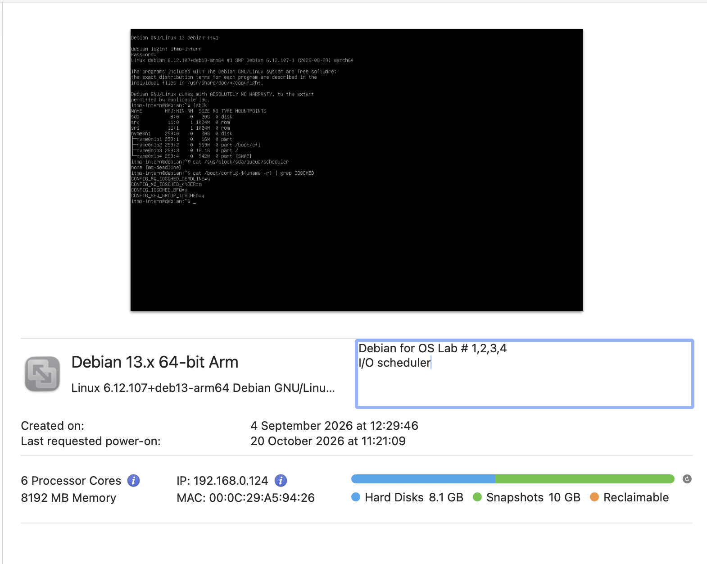
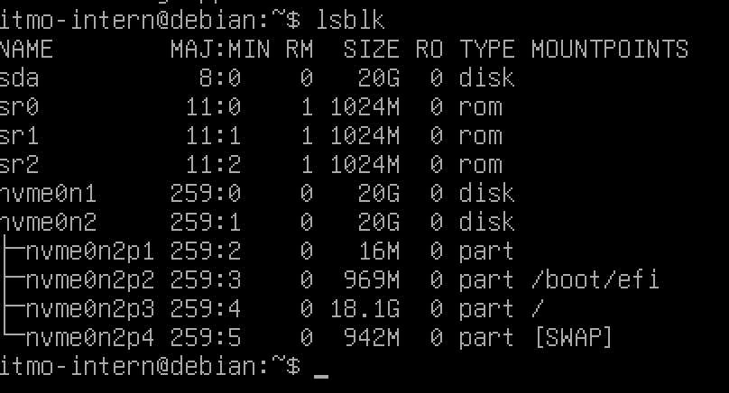
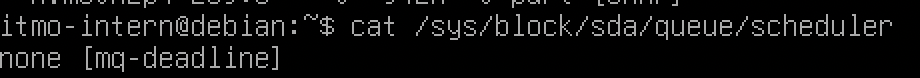
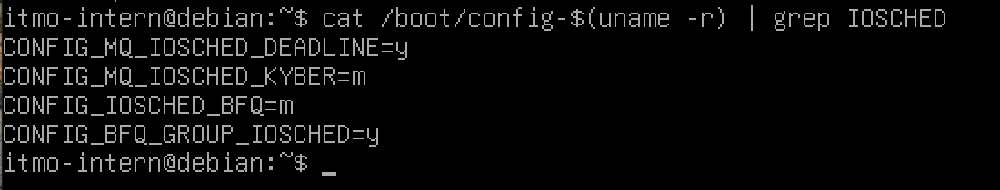
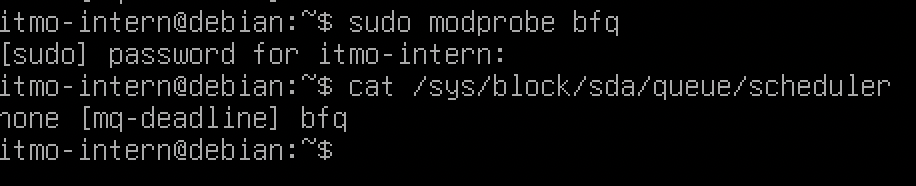
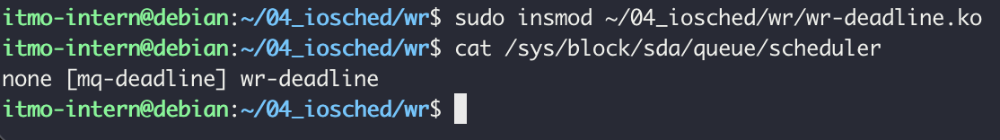

# Вводная часть
## I/O Scheduler: с чем мы имеем дело
Мы уже знаем о существовании планировщика процессов [a-03 Linpack](a-03%20Linpack.md) так зачем же нужен планировщик I/O и зачем он нужен?
В то время как планировщики процессов отвечают за задачу распределения ресурсов процессора между процессами встаёт вопрос: что если процессу нужны данные с диска? а что если нескольким?
Нужно определить приоритет данных и достать их с его учётом. Тут и появляется планировщик устройств ввода/вывода. Его задача оптимальным образом обеспечить доступ процесса к запрашиваемому дисковому устройству. 
Работа с дисками относится к очень медленным операциям, имеющая к тому же долгое время поиска нужной информации, а процессов терпеливо ожидающих своей очереди может быть очень много. Поэтому алгоритм I/O scheduler должен с одной стороны уметь уменьшать время поиска информации на диске, ведь частое
переключение между задачами приведет к тому, что головка диска будет большую часть времени будет просто переходить на разные позиции. Также I/O scheduler должен уметь выдавать информацию в соответствии с приоритетом и гарантировать получение данных приложению за определенное время и в нужном количестве.

## Типы планировщиков (историческая справка)
- [Noop](#Noop)
- [Deadline](#Deadline)
- [Anticipatory](#Anticipatory)
- [CFQ](#CFQ)
- [BFQ](#BFQ)
- [blk-mq](#blk-mq)
---
### Noop
(No Operation)
Наиболее простой планировщик. Он банально помещает все запросы в очередь FIFO и исполняет их вне зависимости от того, пытаются ли приложения читать или писать. Планировщик этот, тем не менее, пытается объединять однотипные запросы для сокращения операций ввода/вывода. Потребляет меньшее кол-во ресурсов.
>[!tip]
Предназначен NOOP в основном для работы с не дисковыми устройствами (ОЗУ или флэшдиск)
### Deadline
Задачей алгоритма Deadline является минимизация задержек ввода/вывода,
и обспечение поведения, близкого к реальному времени. В нем использовано
5 очередей ввода/вывода, а планировщик использует алгоритм предельного
срока для улучшения производительности постоянно переупорядочивая
запросы. Кратко суть алгоритма заключается в том, что операциям чтения
всегда отдается предпочтение перед операциями записи.
Кроме того, запросы объединяются в пакеты. Пакетом называется последовательность запросов на чтение либо на запись, которая идет в сторону больших секторов («алгоритм лифта»). После его обработки планировщик смотрит, есть ли запросы на запись, которые не обслуживались длительное время, и в зависимости от этого решает, создавать ли пакет на чтение либо же на запись.
>[!Note]
>Данный алгоритм больше подходит для систем, в которых количество считываемой информации превосходит количество записываемой, например базы данных или веб-сервер.

>[!Warning]
>Алгоритм лифта:
>Алгоритм заключается в движении головки диска по блинам. По мере движения в одну сторону головка обслуживает все встречающиеся операции ввода-вывода. Далее головка движется в обратном направлении, выполняя то же самое.
### Anticipatory
(упреждающий конвейер)
Основан на Deadline, его алгоритм позволяет минимизировать перемещение головки по диску. Для этого перед запросом вводится некая управляемая задержка, при помощи которой достигается переупорядочение и объединение операций обращения к диску.
### CFQ
(Completely Fair Queuing)
Заключается его алгоритм в следующем. Каждому процессу назначается своя очередь запросов ввода/вывода. Каждой очереди затем присваивается квант времени. Планировщик же циклически обходит все процессы и обслуживает каждый из них, пока не закончится очередь либо не истечет заданный квант времени. Если очередь закончилась раньше, чем истек выделенный для нее квант времени, планировщик подождет (по умолчанию 10 мс) и, в случае напрасного ожидания, перейдет к следующей очереди. Отмечу, что в рамках каждой очереди чтение имеет приоритет над записью.
### BFQ
(Budget Fair Queueing)
Базируется на CFQ. Если не вдаваться в технические подробности, каждой очереди (которая, как и в CFQ, назначается попроцессно) выделяется свой «бюджет», и, если процесс интенсивно работает с диском, данный «бюджет» увеличивается.
### blk-mq
(Multiqueue Block Layer)
Запрос сначала попадает в программную очередь. Количество этих очередей равно количеству ядер процессора. После прохождения программной очереди запрос попадает в очередь отправки. Количество очередей отправки уже зависит от драйвера устройства, который может поддерживать от 1 до 2048 очередей. Так как работа планировщика осуществляется на уровне программных очередей, то запрос из любой программной очереди может попасть в любую очередь отправки, предоставляемую драйвером.
Механизм **blk-mq** был разработан после появления NVMe-дисков, когда стало ясно, что стандартные средства ядра не дают необходимой производительности. Он был добавлен в ядро 3.13, однако планировщики были написаны позже. В новейших версиях ядра Linux (≥4.12) имеются следующие планировщики для blk-mq: none, bfq, mq-deadline и kyber. Рассмотрим каждый из этих планировщиков подробнее.
## blk-mq планировщики
Старые I/O планировщики были заменены их новыми версиями/новыми. Из них
- __none__ — режим, при котором I/O scheduler отключён. - Режим `none` является стандартом де-факто для высокоскоростных NVMe-накопителей. Поскольку современные быстрые SSD имеют тысячи аппаратных очередей и высокую степень параллелизма, классические планировщики создают лишние накладные расходы на процессор и могут снижать скорость работы.
- __bfq__ — реализация bfq с использованием blk-mq.
- __mq-deadline__ — реализация deadline с использованием blk-mq.
- __kyber__ — был написан для работы с быстрыми устройствами. Используя две очереди — запросы на запись и на чтение, kyber отдает приоритет запросам на чтение, перед запросами на запись. Алгоритм измеряет время завершения каждого запроса и корректирует фактический размер очереди для достижения установленных в настройках задержек.

## Параметры mq-deadline (усложнённая часть)
Разберём код планировщика mq-deadline при помощи ии, чтобы понять, какие настройки там есть и что можно поменять.

### Ещё чутка про работу
Планировщик держит для каждого направления (чтение, запись) две структуры: очередь по номеру сектора и очередь по времени прихода (FIFO со сроком). Решает он в два этапа:
1. **Выбор направления** на каждую «пачку»: читать или писать.
2. **Выбор запроса внутри направления**: идти по возрастанию секторов, а если срок у самого старого запроса истёк, начать с него.
>[!Note]
>Про пачки: диск принимает запросы на чтение и запись по одному. Каждый раз, когда диск готов принять запрос, планировщик отдаёт ему один запрос из очереди. Эта очередь и есть пачка -- серия запросов, соответствующая одному типу операции (чтение/запись). Важно: проходя по этой очереди тип операции не меняется!
>Т.е чем меньше пачка, тем быстрее сменяет чтение за запись и наоборот.

>[!Note]
>Срок влияет только на выбор запроса внутри направления, на выбор самого направления нет.

### Рассмотрим несколько параметров планировщика
| Параметр            | По умолчанию        | За что отвечает                                                                              |
| ------------------- | ------------------- | -------------------------------------------------------------------------------------------- |
| `read_expire`       | 500 мс              | Срок «мягкого дедлайна» чтения. Задаётся при вставке запроса. В sysfs в миллисекундах        |
| `write_expire`      | 5000 мс             | То же для записи                                                                             |
| `writes_starved`    | 2                   | Сколько пачек чтения подряд можно отдать, пока ждёт запись                                   |
| `fifo_batch`        | 16                  | Размер пачки: сколько запросов подряд идут в одном направлении по порядку секторов           |
| `front_merges`      | 1                   | Разрешить слияние нового запроса с уже стоящим «спереди» (0 или 1)                           |
| `async_depth`       | равен `nr_requests` | Сколько тегов могут занять записи и асинхронные запросы. Синхронное чтение не ограничивается |
| `prio_aging_expire` | 10 с                | Через сколько отдавать запросы низкого класса `ioprio` при наличии высоких                   |


__Цель:__
Изменить параметры `mq-deadline` так, чтобы изменился приоритет с чтения на запись. Для этого изменим константы внутри модуля планировщика (саму логику не меняю, т.к не умею):
Для выполнения цели поменяем сроки чтения и записи (`read_expire` и `write_expire`), количество пачек чтения, которые можно отдать, пока идёт запись (`writes_starved`) и размер пачки (`fifo_batch`). 
Выполним настройку таковой, что в очереди на выполнение всегда будет запись.
__Будем менять параметры постепенно (лесенкой), чтобы их влияние на конечную цель__

Было:
```c
static const int read_expire = HZ / 2;
static const int write_expire = 5 * HZ;


static const int prio_aging_expire = 10 * HZ;
static const int writes_starved = 2; 
static const int fifo_batch = 16; 
```

Стало:
```c
static const int read_expire = 5 * HZ;
static const int write_expire = HZ / 2;


static const int prio_aging_expire = 10 * HZ;
static const int writes_starved = 0; 
static const int fifo_batch = 64; 
```

Изменения:
-  `read_expire` — wr-deadline-1
- `write_expire` — wr-deadline-2
- `writes_starved = 0` — wr-deadline-3
- `fifo_batch = 64` — wr-deadline

## Бенчмарк
Для проведения сравнения выбран бенчмарк [fio - Flexible I/O tester](https://www.mankier.com/1/fio#Job_Parameters-Units).
В основе fio лежит идея моделирования реальных сценариев нагрузки с помощью создания множества параллельных потоков или процессов, которые выполняют операции ввода-вывода по заданным правилам.
Тест проверяет напрямую блочное устройство, наличие файловой системы не обязательно (исключается влияние настроек фс на проверку непосредственно диска). 
Для работы программы необходим конфиг с настройками бенчмарка. Разберём параметры, которые будут использоваться при написании конфига:
>[!NOTE]
>__\[global\]__ (общие настройки)
>- ioengine — программный интерфейс, через который fio отправляет запросы. (`sync`, `psync`, `libaio`, `io_uring`, `mmap`, `posixaio` и др.)
>- blocksize — размер блока данных для одной отдельной операции ввода-вывода. ( `512`, `4k`, `64k`, `1m`)
> - direct — прямой доступ к устройству. Определяет, будет ли задействован страничный кэш оперативной памяти. (`1` - вкл/обойти кэш, `0` - выкл/использовать кэш)
>- iodepth — глубина очереди запросов для каждого потока. Определяет, сколько параллельных незавершённых асинхронных операций может одновременно находится в обработку у накопителя. (`1`, `4`, `8`, `32`, `128` и т.д)
>- time_based — работать все `runtime` секунд (`1` - вкл, `0` - выкл)
>- runtime — ограничение теста по времени в секундах. (`30`, `60`, `7200` и т.д)
>- ramp_time — работа бенчмарка в секундах, не входящая в статистику (для прогрева) (`30`, `60`, `7200` и т.д)
>- random_generator — определяет математический алгоритм, по которому генерируется псевдослучайные смещения при случайном доступе. ( `lfsr`, `tausworthe`)
>- group_reporting — сбор статистики по группам процессов (`1` - вкл, `0` - выкл)
>- lat_percentiles — процентили считаются по полной задержке (`1` - вкл, `0` - выкл)
>- percentile_list — какие процентили выводить
>- filename — задаёт объект для тестирования. (`/dev/nvme0n1p1`, `/dev/sda` и т.д)
>- size — размер накопителя
>__\[writers\]__ (Писатели)
>- numjobs — степень параллелизма задачи т.е сколько независимых потоков будет создано для выполнения этой секции. (`1`, `2`, `10`, `64` и т.д)
>- rw — тип доступа к данным. ( `read`, `write`, `randread`, `randwrite`, `rw`, `randrw`, `trim`, `randtrim`)
>- new_group — создание группы
>__\[readers\]__ (Читатели)
>- numjobs — степень параллелизма задачи т.е сколько независимых потоков будет создано для выполнения этой секции. (`1`, `2`, `10`, `64` и т.д)
>- rw — тип доступа к данным. ( `read`, `write`, `randread`, `randwrite`, `rw`, `randrw`, `trim`, `randtrim`)
>- rwmixread — процентное соотношение операций чтения и записи при использовании смешанных паттернов - процент чтения. (от `0` до `100`)
>- new_group — создание группы

# Настройка ВМ + бенчмарка
## ВМ
### Конфигурация
Для теста используется ВМ на Debian, 6 ядер, 8 ГБ оперативной памяти.

Ядро: Linux debian 6.12.107+deb13-arm64 
### Диски
Будет тестироваться 2 виртуальных диска:
- nvme0n1
- sda


### Тестируемые планировщики ввода-вывода 
Изначально доступны в использовании:
- none
- mq-deadline


посмотрим, какие планировщики есть на устройстве:
- mq-deadline (y)
- kyber (m)
- bfq (m)
- поддержка группового управления для bfq (y)


>[!Примечание]
>Команда `cat /boot/config-$(uname -r) | grep IOSCHED` показывает параметры конфигурации текущего ядра линукс. Фильтрация по `IOSCHED` показывает только параметры планировщика ввода-вывода.
>\* y (yes) — вшит в ядро. готов к работе
>\* m (module) — представлен в виде модуля, который нужно загрузить. 

Подгрузим недастающие модули и можем приступать к тестам

## Бенчмарк
работаем на fio-3.39
Так как мы будем тестировать разные планировщики, которые рассчитаны на разные задачи (приоритет чтение/запись) будет правильно прогнать не один тест.

### Конфигфайл fio. Приоритет: чтение
```
[global]
ioengine=libaio
direct=1
bs=4k
iodepth=4
time_based=1
runtime=600
ramp_time=30
random_generator=lfsr
group_reporting=1
lat_percentiles=1
percentile_list=99:99.9:99.99
filename=${FDISK}
size=19G

[readers]
rw=randread
numjobs=10
new_group

[mixed_80_read]
rw=randrw
rwmixread=80
numjobs=2
new_group
```

### Конфигфайл fio. Приоритет: запись
```
[global]
ioengine=libaio
direct=1
bs=4k
iodepth=4
time_based=1
runtime=600
ramp_time=30
random_generator=lfsr
group_reporting=1
lat_percentiles=1
percentile_list=99:99.9:99.99
filename=${FDISK}
size=19G

[writers]
rw=randwrite
numjobs=10
new_group

[mixed_20_read]
rw=randrw
rwmixread=20
numjobs=2
new_group
```

### Пояснения:
- ioengine=libaio — асинхронный интерфейс ядра: отправляет несколько запросов и не ждёт каждого. (нужно для создания очереди)
- direct=1 — обход оперативной памяти, сразу в диск.
- random_generator=lfsr — способ генерации случайных смещений. Дешевле по CPU, чем стандартный.
- FDISK (Full Disk)— переменная полного пути диска
# Ход работы
## Предзаполнение диска
Для начала предзаполним диск командой:
```bash
sudo fio --name=prefill --filename=${FDISK} --rw=write --bs=1M --direct=1 --ioengine=libaio --iodepth=16 --size=100%
```

## Параметры измерения
| Параметр                        | Что это                                                                                                                                                                | Как читать                                                                                                                       |
| ------------------------------- | ---------------------------------------------------------------------------------------------------------------------------------------------------------------------- | -------------------------------------------------------------------------------------------------------------------------------- |
| `disk`                          | тип диска (SATA или NVMe), не имя вида `nvme0nX`                                                                                                                       |                                                                                                                                  |
| `sched`                         | планировщик                                                                                                                                                            |                                                                                                                                  |
| `num`                           | номер повтора (1-3)                                                                                                                                                    |                                                                                                                                  |
| `mode`                          | тест: в `read.fio` читающая нагрузка, в `write.fio` пишущая                                                                                                            |                                                                                                                                  |
| `jobname`                       | группа процессов: `readers` (10 процессов, чистое чтение), `writers` (10, чистая запись), `mixed_80_read` (2, смесь 80% чтения), `mixed_20_read` (2, смесь 20% чтения) | группы работают одновременно и конкурируют за диск                                                                               |
| `dir`                           | направление операции в строке (read или write)                                                                                                                         | у смешанных групп две строки                                                                                                     |
| `iops`                          | операций ввода-вывода в секунду                                                                                                                                        | чем выше, тем лучше                                                                                                              |
| `bw_MiB`                        | пропускная способность                                                                                                                                                 | **производная от IOPS**: блок 4 КиБ, поэтому МиБ/с = IOPS × 4 / 1024 = IOPS ÷ 256 (для `bfq`: 8501 ÷ 256 ≈ 33,2).                |
| `mean_lat_ms`                   | средняя задержка запроса от постановки в очередь до завершения, включая ожидание в планировщике                                                                        | чем ниже, тем лучше. При фиксированной нагрузке примерно равна числу запросов в полёте, делённому на IOPS, поэтому тоже вторична |
| `p99_ms`, `p999_ms`, `p9999_ms` | перцентили задержки (см. п. 2)                                                                                                                                         | чем ниже, тем лучше                                                                                                              |
| `max_lat_ms`                    | самый долгий запрос за прогон                                                                                                                                          | в ВМ зависит от хоста, для выводов ненадёжен                                                                                     |

## Монтирование wr-deadline
Скачаем с [архива](https://cdn.kernel.org/pub/linux/kernel/v6.x/) свою версию ядра. Распакуем с помощью команды
```bash
tar -xf linux-6.12.107.tar.xz linux-6.12.107/block/mq-deadline.c
```
Собираем ядро и монтируем в систему:


## Проведение тестов
>[!Примечание]
В первой части работы измерим характеристики планировщиков:
>   \* none
>   \* mq-deadline
>   \* bfq
>   \* kyber
>Следом изменим планировщик на уровне ядра __mq-deadline__ и сравним его с искомым.
>

### Сводные таблицы результатов (представлены не все параметры)
Подробнее можете посмотреть в [Приложении](a-04%20IO%20Scheduler.md#Логи)
### Default
#### Sda

Средние значения IOPS:

| Планировщик | mixed 20 (r) | mixed 80 (r) |  readers | mixed 20 (w) | mixed 80 (w) | writers |
| ----------- | -----------: | -----------: | -------: | -----------: | -----------: | ------: |
| bfq         |       241,96 |      1658,67 | 10369,48 |       967,14 |       414,50 | 5078,61 |
| kyber       |       216,33 |      1566,64 | 10735,08 |       864,45 |       391,44 | 5081,51 |
| mq-deadline |       208,24 |      1534,75 | 10251,25 |       831,65 |       383,65 | 5008,28 |
| none        |       196,49 |      1531,29 |  9478,95 |       783,43 |       382,77 | 4866,15 |


Диапазон IOPS (минимум–максимум):

| Планировщик |    mixed 20 (r) |    mixed 80 (r) |           readers |    mixed 20 (w) |  mixed 80 (w) |         writers |
| ----------- | --------------: | --------------: | ----------------: | --------------: | ------------: | --------------: |
| bfq         |   215,07–293,20 | 1563,17–1731,02 |  9770,51–10822,95 |  858,52–1172,85 | 390,40–432,45 | 4436,76–5434,74 |
| kyber       |   213,25–220,49 | 1553,60–1575,55 | 10554,21–10890,89 |   851,72–881,57 | 388,03–393,69 | 5011,69–5187,56 |
| mq-deadline |   204,21–214,94 | 1451,25–1623,79 |  9691,28–10846,53 |   815,09–858,86 | 362,62–406,36 | 4907,51–5173,89 |
| none        |   189,28–201,97 | 1418,36–1631,84 |  8764,48–10084,32 |   754,11–806,01 | 354,37–408,39 | 4633,76–5006,96 |


Средний `p99` (мс):

| Планировщик | mixed 20 (r) | mixed 80 (r) | readers | mixed 20 (w) | mixed 80 (w) | writers |
| ----------- | -----------: | -----------: | ------: | -----------: | -----------: | ------: |
| bfq         |        25,08 |         6,08 |    6,08 |        27,44 |         6,15 |   45,96 |
| kyber       |        20,32 |         5,89 |    5,87 |        26,35 |        16,91 |   26,61 |
| mq-deadline |        24,34 |         7,74 |    7,70 |        31,20 |        10,94 |   31,20 |
| none        |        38,14 |        13,74 |   13,83 |        38,23 |        13,70 |   39,02 |


Диапазон `p99` (минимум–максимум, мс):

| Планировщик | mixed 20 (r) | mixed 80 (r) |     readers | mixed 20 (w) | mixed 80 (w) |     writers |
| ----------- | -----------: | -----------: | ----------: | -----------: | -----------: | ----------: |
| bfq         |  19,79–34,34 |    5,87–6,32 |   5,87–6,32 |  19,79–41,68 |    6,00–6,39 | 19,79–96,99 |
| kyber       |  18,22–22,15 |    5,73–6,00 |   5,73–5,93 |  23,72–28,70 |  16,91–16,91 | 23,99–28,97 |
| mq-deadline |  21,63–27,39 |    7,31–8,16 |   7,24–8,09 |  28,18–35,39 |  10,29–11,47 | 28,18–35,39 |
| none        |  33,16–46,40 |  11,86–16,45 | 11,86–16,71 |  32,90–46,40 |  11,73–16,45 | 33,16–47,97 |


#### Nvme

Средние значения IOPS:

| Планировщик | mixed 20 (r) | mixed 80 (r) | readers | mixed 20 (w) | mixed 80 (w) | writers |
| ----------- | -----------: | -----------: | ----------: | -----------: | -----------: | ----------: |
| bfq         |   166,398726 |  1221,782023 |     8501,09 |   664,552517 |  305,1898047 | 4502,544694 |
| kyber       |   200,759377 |  1274,258810 | 9132,952245 |   802,763548 |   318,139836 | 4722,822546 |
| mq-deadline |   246,355086 |  1697,012467 | 8271,944299 |   984,585378 |   424,012273 | 4431,846685 |
| none        |   185,022665 |  1645,506177 | 8943,986600 |   740,337325 |   411,521858 | 4581,744596 |


Диапазон IOPS (минимум–максимум):

| Планировщик |          mixed 20 (r) |            mixed 80 (r) |                 readers |           mixed 20 (w) |          mixed 80 (w) |                 writers |
| ----------- | --------------------: | ----------------------: | ----------------------: | ---------------------: | --------------------: | ----------------------: |
| bfq         | 139,655387–210,258136 | 1071,104935–1518,136198 | 8132,483112–9141,969756 |  558,144691–839,489593 | 266,790550–379,983614 | 4301,700367–4689,592854 |
| kyber       | 159,087803–232,263806 | 1082,382621–1547,005098 | 8695,996366–9692,209149 |  635,397720–928,871897 | 269,958380–386,619781 | 4335,245817–4935,804765 |
| mq-deadline | 228,657080–257,783230 | 1466,025511–2012,274364 | 8041,686483–8434,098609 | 913,886724–1031,376248 | 366,520021–503,155643 | 4199,503464–4574,994318 |
| none        | 153,101357–204,667953 | 1412,393004–2038,362694 | 8419,459067–9297,801856 |  612,355431–819,665137 | 352,902375–510,391493 | 4520,218927–4670,942065 |


Средний `p99` (мс):

| Планировщик | mixed 20 (r) | mixed 80 (r) |  readers | mixed 20 (w) | mixed 80 (w) |   writers |
| ----------- | -----------: | -----------: | -------: | -----------: | -----------: | --------: |
| bfq         |    34,559317 |     7,460181 | 6,804821 |    34,384555 |     7,372800 | 31,544661 |
| kyber       |    27,088213 |     6,914048 | 6,389760 |    27,350358 |     8,377685 | 27,131904 |
| mq-deadline |    24,597845 |     6,455296 | 7,088811 |    24,335701 |     6,477141 | 28,792149 |
| none        |    27,219285 |     6,848512 | 7,045120 |    27,743573 |     6,761131 | 26,957141 |


Диапазон `p99` (минимум–максимум, мс):

| Планировщик |        mixed 20 (r) |      mixed 80 (r) |           readers |        mixed 20 (w) |       mixed 80 (w) |             writers |
| ----------- | ------------------: | ----------------: | ----------------: | ------------------: | -----------------: | ------------------: |
| bfq         |  25,55904–41,156608 |   6,38976–8,35584 | 6,651904–6,914048 |  25,55904–40,108032 |   6,258688–8,35584 | 27,394048–35,913728 |
| kyber       |  20,840448–35,38944 |  6,586368–7,37280 | 6,127616–6,782976 |  21,62688–35,913728 |   6,914048–9,50272 |  22,675456–30,80192 |
| mq-deadline | 23,724032–25,821184 | 5,537792–6,979584 | 6,455296–7,503872 |  22,93760–25,821184 |  5,603328–6,914048 | 26,345472–31,326208 |
| none        |  23,199744–32,11264 | 6,193152–7,634944 | 6,782976–7,307264 | 23,461888–33,161216 |  6,193152–7,569408 | 23,986176–32,636928 |


### wr-deadline
#### Sda

Средние значения IOPS:

| Планировщик | mixed 20 (r) | mixed 80 (r) | readers | mixed 20 (w) | mixed 80 (w) | writers |
| ----------- | -----------: | -----------: | ------: | -----------: | -----------: | ------: |
| wr-deadline-1 | 202,229067 | 1385,393750 | 9252,688663 | 807,294083 | 346,2676053 | 4860,765617 |
| wr-deadline-2 | 210,6246967 | 1437,448682 | 9603,450344 | 841,8421747 | 359,119952 | 5065,470530 |
| wr-deadline-3 | 1098,144683 | 1584,588872 | 9535,642117 | 4393,548724 | 396,2258283 | 5984,609540 |
| wr-deadline-4 | 790,1365767 | 1501,345024 | 9273,842103 | 3156,058575 | 375,4845873 | 6287,009734 |


Диапазон IOPS (минимум–максимум):

| Планировщик | mixed 20 (r) | mixed 80 (r) | readers | mixed 20 (w) | mixed 80 (w) | writers |
| ----------- | -----------: | -----------: | ------: | -----------: | -----------: | ------: |
| wr-deadline-1 | 197,351360–211,402439 | 1348,568686–1409,021213 | 9004,219930–9412,985074 | 787,955454–844,433111 | 336,985507–352,231970 | 4744,086746–5083,877763 |
| wr-deadline-2 | 195,033830–220,321979 | 1375,678324–1485,161914 | 9193,647418–9916,351952 | 778,748792–880,984601 | 343,798749–371,047149 | 4685,086003–5302,562547 |
| wr-deadline-3 | 1084,379437–1111,892587 | 1501,206651–1652,041306 | 9031,172814–9939,830802 | 4339,367738–4447,627016 | 375,058333–413,407821 | 5790,995724–6171,385430 |
| wr-deadline-4 | 0,013333–1200,455330 | 1398,394688–1643,348089 | 8636,082732–10154,704090 | 0,030000–4794,818035 | 349,692004–411,291183 | 6201,650562–6373,350088 |

Средний `p99` (мс):

| Планировщик | mixed 20 (r) | mixed 80 (r) | readers | mixed 20 (w) | mixed 80 (w) | writers |
| ----------- | -----------: | -----------: | ------: | -----------: | -----------: | ------: |
| wr-deadline-1 | 26,607616 | 8,596139 | 8,596139 | 33,641813 | 12,211541 | 33,729195 |
| wr-deadline-2 | 22,588075 | 8,279381 | 8,279381 | 28,398933 | 11,818325 | 28,486315 |
| wr-deadline-3 | 7,634944 | 8,530603 | 8,628907 | 7,678635 | 5,668864 | 23,724032 |
| wr-deadline-4 | 5708,207445 | 8,923819 | 8,923819 | 19,136512 | 7,088811 | 19,529728 |


Диапазон `p99` (минимум–максимум, мс):

| Планировщик | mixed 20 (r) | mixed 80 (r) | readers | mixed 20 (w) | mixed 80 (w) | writers |
| ----------- | -----------: | -----------: | ------: | -----------: | -----------: | ------: |
| wr-deadline-1 | 22,151168–31,588352 | 29,491200–38,010880 | 8,355840–8,847360 | 11,993088–12,517376 | 8,355840–8,847360 | 29,229056–38,535168 |
| wr-deadline-2 | 18,219008–29,491200 | 23,199744–36,438016 | 8,028160–8,585216 | 11,468800–12,255232 | 8,028160–8,585216 | 23,461888–36,438016 |
| wr-deadline-3 | 6,914048–8,224768 | 6,979584–8,224768 | 8,290304–8,847360 | 5,537792–5,799936 | 8,454144–8,978432 | 21,364736–26,607616 |
| wr-deadline-4 | 5,537792–17112,760320 | 5,603328–45,350912 | 8,028160–9,764864 | 6,258688–7,831552 | 8,028160–9,764864 | 18,481152–21,102592 |

#### Nvme

Средние значения IOPS:

| Планировщик   | mixed 20 (r) | mixed 80 (r) |     readers | mixed 20 (w) | mixed 80 (w) |     writers |
| ------------- | -----------: | -----------: | ----------: | -----------: | -----------: | ----------: |
| wr-deadline   |  200,7906077 |  1625,910325 | 7969,484660 |  802,7203483 |  406,5673397 | 4891,147943 |
| wr-deadline-1 |  177,5588507 |  1450,865665 | 8212,886926 |   709,452077 |  362,2156147 | 4840,881606 |
| wr-deadline-2 |  150,4874187 |  1616,830495 | 7777,563698 |   601,922861 |   403,945046 | 4676,047604 |
| wr-deadline-3 |  189,1494103 |  1400,433982 | 7955,635569 |  757,1596757 |  350,1305277 | 4627,054023 |


Диапазон IOPS (минимум–максимум):

| Планировщик | mixed 20 (r) | mixed 80 (r) | readers | mixed 20 (w) | mixed 80 (w) | writers |
| ----------- | -----------: | -----------: | ------: | -----------: | -----------: | ------: |
| wr-deadline | 160,107590–223,516628 | 1298,024999–1886,454196 | 7624,613271–8224,555520 | 641,043925–893,116540 | 324,120093–471,885654 | 4594,331736–5056,181685 |
| wr-deadline-1 | 156,862810–208,384858 | 882,757057–2156,602416 | 7214,920534–8751,155617 | 625,667914–833,296113 | 219,735934–538,855917 | 4369,687793–5117,342852 |
| wr-deadline-2 | 115,123740–187,230469 | 1489,211846–1811,003515 | 7433,370283–7993,841105 | 460,944921–746,842277 | 372,043799–452,126127 | 4322,182169–5163,541245 |
| wr-deadline-3 | 184,630506–196,705558 | 1264,576642–1542,007962 | 7641,486286–8225,655657 | 740,997534–786,159486 | 316,028048–385,391157 | 3989,757586–5198,657852 |

Средний `p99` (мс):

| Планировщик | mixed 20 (r) | mixed 80 (r) | readers | mixed 20 (w) | mixed 80 (w) | writers |
| ----------- | -----------: | -----------: | ------: | -----------: | -----------: | ------: |
| wr-deadline | 31,02037333 | 7,350954667 | 7,897088 | 29,40381867 | 7,394645333 | 28,87953067 |
| wr-deadline-1 | 37,486592 | 7,962624 | 7,53664 | 39,059456 | 7,776938667 | 34,55931733 |
| wr-deadline-2 | 41,156608 | 7,110656 | 7,86432 | 40,98184533 | 7,066965333 | 35,38944 |
| wr-deadline-3 | 32,94276267 | 7,187114667 | 7,449258667 | 32,85538133 | 7,176192 | 31,89418667 |


Диапазон `p99` (минимум–максимум, мс):

| Планировщик | mixed 20 (r) | mixed 80 (r) | readers | mixed 20 (w) | mixed 80 (w) | writers |
| ----------- | -----------: | -----------: | ------: | -----------: | -----------: | ------: |
| wr-deadline | 26,083328–36,438016 | 6,455296–8,224768 | 7,438336–8,159232 | 26,083328–32,112640 | 6,586368–8,159232 | 27,656192–30,801920 |
| wr-deadline-1 | 36,438016–39,583744 | 6,717440–8,716288 | 6,455296–8,585216 | 36,962304–42,205184 | 6,586368–8,454144 | 32,374784–37,486592 |
| wr-deadline-2 | 36,438016–45,350912 | 6,127616–8,028160 | 7,307264–8,454144 | 35,913728–45,875200 | 6,127616–7,962624 | 34,340864–36,438016 |
| wr-deadline-3 | 29,491200–35,913728 | 6,258688–8,454144 | 6,717440–8,847360 | 30,015488–35,913728 | 6,127616–8,355840 | 29,753344–33,816576 |

# Выводы

## Default

В режиме `Default` на `sda` лучшим для чистого чтения оказался `kyber`: 10 735 IOPS при среднем `p99` 5,87 мс. `bfq` был немного слабее по чтению — 10 369 IOPS, но показал лучший результат в смешанной нагрузке с 80 % чтения: 1 659 IOPS чтения и 414 IOPS записи. Это показывает, что `bfq` лучше распределяет конкурирующие запросы, когда одновременно работают читатели и писатели.

Для чистой записи планировщики `bfq`, `kyber` и `mq-deadline` дали близкие результаты — примерно 5 008–5 082 IOPS. При этом `kyber` имел наименьший средний `p99` среди этих вариантов — 26,61 мс. Планировщик `none` уступил остальным по IOPS и имел самые высокие задержки в большинстве сценариев: например, 13,83 мс в чистом чтении против 5,87 мс у `kyber`.

На NVMe картина отличается. В чистом чтении лучшим по средней производительности был `kyber` — 9 133 IOPS, а в смешанной нагрузке с 80 % чтения — `mq-deadline` с 1 697 IOPS чтения и 424 IOPS записи. В чистой записи `kyber` дал 4 723 IOPS, но разница с `none` и `mq-deadline` была небольшой. Следовательно, для обычных планировщиков выбор зависит от профиля нагрузки: `kyber` хорошо подходит для параллельного чтения и записи, `bfq` — для справедливого обслуживания смешанных запросов, а `mq-deadline` — для ограничения задержек в отдельных смешанных сценариях.

## wr-deadline: влияние параметров

В модифицированном планировщике были изменены четыре параметра: `read_expire`, `write_expire`, `writes_starved` и `fifo_batch`. По обозначениям прогонов `wr-deadline-1` соответствует изменению `read_expire`, `wr-deadline-2` — `write_expire`, `wr-deadline-3` — `writes_starved = 0`, а `wr-deadline-4` — увеличению `fifo_batch` до 64.

### `read_expire` — `wr-deadline-1`

Увеличение срока чтения с 0,5 до 5 секунд уменьшает срочность чтения. На `sda` вариант дал относительно низкие значения в `mixed_20_read`: 202 IOPS чтения и 807 IOPS записи. На NVMe он дал 178 IOPS чтения и 709 IOPS записи, а средний `p99` в этом сценарии вырос до 37,49 мс для чтения и 39,06 мс для записи. Это согласуется с гипотезой, что длинный срок чтения позволяет дольше накапливать и обслуживать записи, ухудшая задержку смешанной нагрузки.

### `write_expire` — `wr-deadline-2`

Уменьшение срока записи с 5 до 0,5 секунды делает запись более срочной. На `sda` вариант `wr-deadline-2` дал 5 066 IOPS в чистой записи, но в `mixed_20_read` получил только 211 IOPS чтения и 842 IOPS записи. На NVMe результат был слабее: 4 676 IOPS в чистой записи, а в `mixed_20_read` — 150 IOPS чтения и 602 IOPS записи. Одновременно средний `p99` NVMe в этом сценарии вырос до 41,16 мс для чтения и 40,98 мс для записи. Вероятно, более жёсткий срок записи усиливает конкуренцию за очередь и не даёт заметного выигрыша в общей производительности.

### `writes_starved = 0` — `wr-deadline-3`

Запрет голодания записи означает, что планировщик не должен пропускать пачки чтения перед ожидающей записью. Именно этот параметр сильнее всего проявился на `sda`: в `mixed_20_read` запись выросла до 4 394 IOPS, а в чистой записи — до 5 985 IOPS. Цена — ухудшение чтения в записи-насыщенной смеси: чтение получило 1 098 IOPS, то есть его доля стала заметно меньше, чем у записи.

На NVMe эффект был менее выражен: `wr-deadline-3` дал 4 627 IOPS в чистой записи, что хуже обычных планировщиков `kyber` и `none`. Поэтому параметр действительно усиливает приоритет записи, но результат зависит от устройства и виртуального пути к нему.

### `fifo_batch = 64` — `wr-deadline-4`

Увеличение размера пачки с 16 до 64 позволяет дольше обслуживать запросы одного направления и уменьшает число переключений между чтением и записью. На `sda` это дало 6 287 IOPS в чистой записи — лучший результат среди вариантов `wr-deadline`, но в `mixed_20_read` запись оказалась ниже, чем у `wr-deadline-3`: 3 156 против 4 394 IOPS. Это указывает на компромисс между пропускной способностью последовательной пачки и справедливостью между направлениями.

На NVMe вариант `wr-deadline-4` дал 4 891 IOPS в чистой записи и 803 IOPS записи в `mixed_20_read`, но уступил стандартному `kyber` в чистой записи. Следовательно, большой `fifo_batch` может быть полезен для записи на `sda`, но не переносится напрямую на NVMe.

Во всех случаях `wr-deadline` нужно оценивать не только по IOPS. Приоритет записи способен повысить производительность записи, но одновременно увеличить задержку чтения и ухудшить смешанную нагрузку. Кроме того, вариант `wr-deadline-4` имеет аномально широкий диапазон значений на `sda` (`0,013333–1200,455330` IOPS в `mixed_20_read` и `0,030000–4794,818035` в записи)

## Сравнение
В целом `sda` оказался быстрее `nvme` почти во всех сопоставимых сценариях. В `Default` чистое чтение на `sda` достигало 10 735 IOPS против 9 133 IOPS на NVMe, а чистая запись — около 5 082 против 4 723 IOPS. Для `wr-deadline` разрыв также сохранялся: на `sda` лучшие варианты достигали 5 985–6 287 IOPS в чистой записи, тогда как на NVMe — около 4 627–4 891 IOPS.

Эти результаты не означают, что физический SATA-диск быстрее физического NVMe. Тест проводился в виртуальной машине, где `sda` и `nvme0n1` могут использовать разные виртуальные контроллеры, драйверы и backend-хранилища. Основная гипотеза состоит в том, что различие вызвано драйверами гипервизора и разными путями обработки запросов: виртуальное устройство `sda` могло иметь более эффективную реализацию очередей или другие лимиты IOPS, а виртуальный NVMe — дополнительные накладные расходы эмуляции.

## Общий вывод
В этой работе мы проверили влияние планировщиков ввода-вывода на чтение, запись и смешанные нагрузки. Мы узнали, что `Default`-планировщики дают более предсказуемый результат: `kyber` и `bfq` лучше проявили себя в сценариях с чтением, а `mq-deadline` был полезен в отдельных смешанных нагрузках.

Мы также проверили, как изменение параметров `wr-deadline` меняет баланс между чтением и записью. `writes_starved = 0` и большой `fifo_batch` усиливают запись, но могут ухудшить обслуживание чтения; изменение сроков `read_expire` и `write_expire` влияет на срочность запросов и хвостовые задержки. Универсального улучшения не получилось: каждый параметр полезен только для определённого профиля нагрузки.

В нашей виртуальной машине `sda` получился быстрее NVMe. Наиболее вероятное объяснение — различия драйверов и виртуальных контроллеров гипервизора, а не преимущество SATA над NVMe. Поэтому главным результатом работы является не выбор одного «самого быстрого» планировщика, а понимание зависимости производительности от нагрузки, параметров очереди, устройства и виртуальной инфраструктуры.

# Логи
- [Таблица с логами (default)](raw/a-os_04_Table.xlsx)
- [Таблица с логами (wr-deadline)](raw/a-os_04_Table-wr-deadline.xlsx)
# Источники
- [Хабр | Linux I/O Scheduler. Выбираем оптимальный](https://habr.com/ru/articles/81504/)
- [OpenNet | Планировщики ввода/вывода и процессов в Linux](https://www.opennet.ru/base/sys/linux_shedulers.txt.html)
- [xaker | Сравниваем планировщики ввода/вывода ядра Linux](https://xakep.ru/2014/05/11/input-out-linux-planning/)
- [Хабр | blk-mq и планировщики ввода-вывода](https://habr.com/ru/companies/selectel/articles/346844/)
- [fio - Flexible I/O tester](https://fio.readthedocs.io/en/latest/fio_doc.html)
