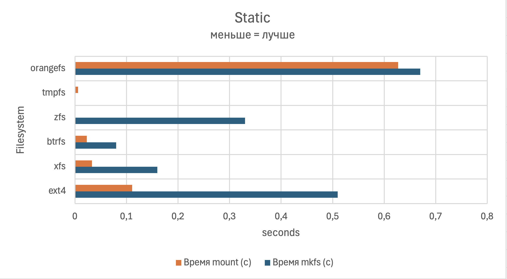
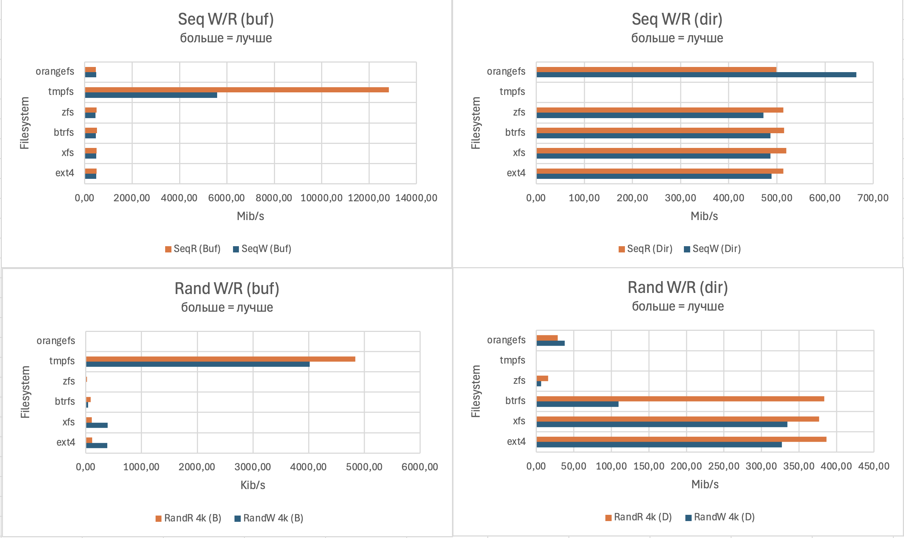
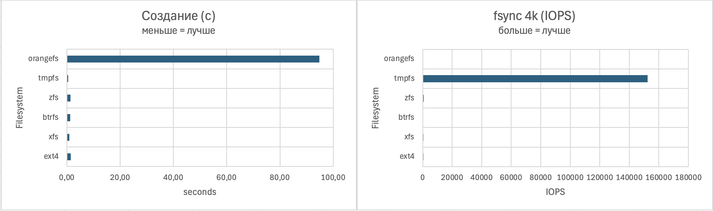
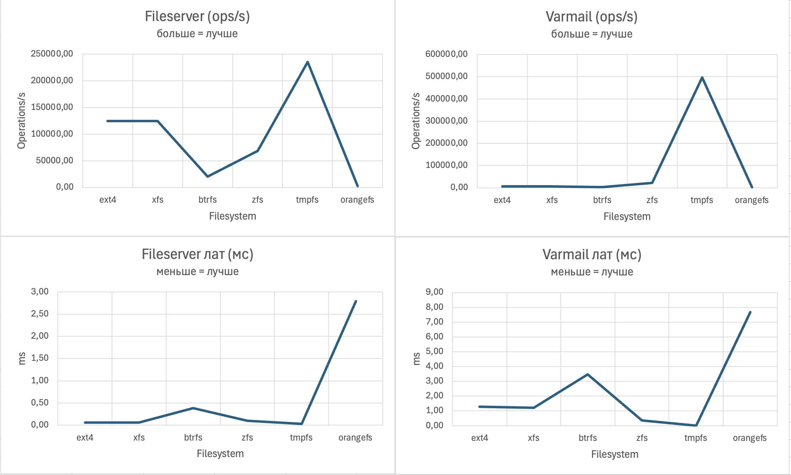
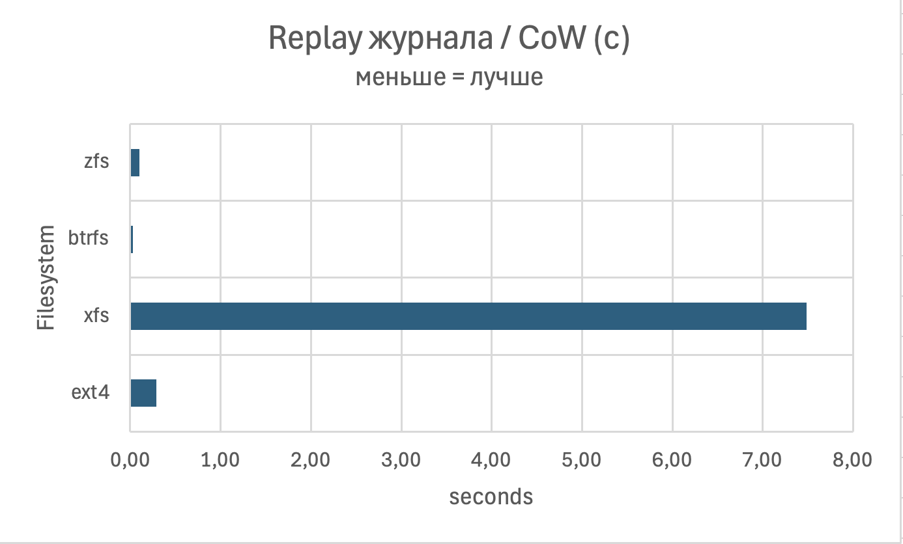

Вся теория описана в другом файле.

# Вводная часть

## Список тестов

| Тест             | Смысл                   | Программа                                    | Настройки                                                                                                                                                                                                                               |
| ---------------- | ----------------------- | -------------------------------------------- | --------------------------------------------------------------------------------------------------------------------------------------------------------------------------------------------------------------------------------------- |
| **Статика**      | накладные расходы       | `time`, `df`, `df -i`                        | время mkfs и mount                                                                                                                                                                                                                      |
| **fio_buf**      | поток и IOPS через кеш  | `fio`                                        | `direct=0 ioengine=psync end_fsync=1 numjobs=4 size=1G`. Фазы со `stonewall`: `write` и `read` при `bs=1M`, `randwrite` и `randread` при `bs=4k`. `runtime=30 time_based ramp_time=5`, перед каждой фазой `exec_prerun` с `drop_caches` |
| **fio_nobuf**    | поток и IOPS без кеша   | `fio`                                        | то же, но `direct=1 ioengine=libaio iodepth=16`, без `end_fsync`. tmpfs пропускаем; ZFS и OrangeFS сначала проверить на O_DIRECT                                                                                                        |
| **fsync**        | цена надёжной записи    | `fio`, `fs_mark`                             | fio: `rw=randwrite bs=4k fsync=1 numjobs=1 runtime=30`; fs_mark: `-S 1 -s 4096 -n 2000 -L 3`                                                                                                                                            |
| **Метаданные**   | много мелких файлов     | `fs_mark`, свой скрипт                       | fs_mark: `-S 0 -s 0 -n 25000 -t 4 -L 3` (реальное число файлов проверь по `Count`); скрипт: `stat`, листинг и удаление, каждое под `time` после `drop_caches`                                                                           |
| **filebench**    | реалистичные смеси      | `filebench`                                  | fileserver и varmail; `$dir` = точка монтирования, набор около 2 ГБ, `$nthreads=8`, `run 60`, перед запуском `drop_caches`                                                                                                              |
| **Порча данных** | заметит ли ФС порчу     | `dd`, `xxd`, `grep`, `sha256sum`, scrub/fsck | файл ~100 МБ с известной меткой, `umount`, порча нескольких байт на устройстве через `dd conv=notrunc`, mount, сверка суммы, scrub или fsck; 3 места порчи                                                                              |
| **Сбой**         | что потеряно при обрыве | `dmsetup` (flakey), свой писатель, fsck      | писатель: запись, `fsync`, номер в лог на системном диске; через 10–30 с flakey переключается на `drop_writes`; после mount и fsck считаем пропавшие подтверждённые номера; 3 момента обрыва                                            |

схема тестов:
Монтирование фс -> тесты (кроме порчи данных и сбоя) -> вайп
порча данных и сбой проверяются отдельно

## Карта тестов

| Группа тестов        | Тест / Метрика                                      | ext4  | xfs   | btrfs | zfs   | tmpfs                                | OrangeFS                               |
| -------------------- | --------------------------------------------------- | ----- | ----- | ----- | ----- | ------------------------------------ | -------------------------------------- |
| **Статика**          | Время `mkfs`, время `mount`                         | **✓** | **✓** | **✓** | **✓** | **✓** _(mount only)_                 | **✓** _(start/mount)_                  |
| **fio (буфер)**      | 1M Seq Write & Read (через Page Cache)              | **✓** | **✓** | **✓** | **✓** | **✓**                                | **✓**                                  |
|                      | 4k Rand Write & Read (через Page Cache)             | **✓** | **✓** | **✓** | **✓** | **✓**                                | **✓*** _(завис в r1, прошёл в r2, r3)_ |
| **fio (Direct I/O)** | 1M Seq Write & Read (`O_DIRECT`, в обход кэша)      | **✓** | **✓** | **✓** | **✓** | **✗** _(O_DIRECT не применим к RAM)_ | **✓**                                  |
|                      | 4k Rand Write & Read (`O_DIRECT`, в обход кэша)     | **✓** | **✓** | **✓** | **✓** | **✗** _(O_DIRECT не применим к RAM)_ | **✓**                                  |
| **Метаданные**       | Создание 25 000 файлов (`fs_mark -S 0`)             | **✓** | **✓** | **✓** | **✓** | **✓**                                | **✓**                                  |
|                      | Холодные листинг (`find`), `stat` и удаление (`rm`) | **✓** | **✓** | **✓** | **✓** | **✓**                                | **✓**                                  |
| **fsync**            | 4k запись с немедленным `fsync=1` (fio)             | **✓** | **✓** | **✓** | **✓** | **✓** _(baseline)_                   | **✓**                                  |
|                      | Создание файлов с fsync на каждый (`fs_mark -S 1`)  | **✓** | **✓** | **✓** | **✓** | **✓** _(baseline)_                   | **✓**                                  |
| **Filebench**        | Профиль `fileserver` (крупные файлы, чтение/запись) | **✓** | **✓** | **✓** | **✓** | **✓**                                | **✓**                                  |
|                      | Профиль `varmail` (тысячи мелких файлов + fsync)    | **✓** | **✓** | **✓** | **✓** | **✓**                                | **✓**                                  |
| **Надёжность**       | **Порча данных** (поиск смещений, затирание 4КБ)    | **✓** | **✓** | **✓** | **✓** | **✗** _(нет блочного диска)_         | **✗** _(данные на сервере)_            |
|                      | **Сбой питания** (`dm-flakey`, потеря WAL, replay)  | **✓** | **✓** | **✓** | **✓** | **✗** _(память сбрасывается)_        | **✗** _(данные на сервере)_            |

# Результаты и их анализ

Во всех тестах tmpfs будет являтся как бы эталоном работы фс. Стоит учесть, что tmpfs запускается на RAM, в то время как остальные на ssd (sata) диске.

 1. Статические параметры (Медиана по повторам)

| ФС       | Время mkfs (с) | Время mount (с) |
| -------- | -------------- | --------------- |
| ext4     | 0.51           | 0.111           |
| xfs      | 0.16           | 0.033           |
| btrfs    | 0.08           | 0.023           |
| zfs      | 0.33           | 0.000           |
| tmpfs    | N/A            | 0.006           |
| orangefs | 0.67           | 0.627           |

Лидером по скорости создания и монтирования является btrfs, так как CoW выделяет структуры динамически, а не размечает таблицу инодов заранее.

OrangeFS медленнее всех — требует старта демонов `pvfs2-server`, `pvfs2-client`

 2. FIO: Скорость передачи данных (МБ/с, медиана)

| ФС       | SeqW (Buf) | SeqR (Buf) | RandW 4k (B) | RandR 4k (B) | SeqW (Dir) | SeqR (Dir) | RandW 4k (D) | RandR 4k (D) |
| -------- | ---------- | ---------- | ------------ | ------------ | ---------- | ---------- | ------------ | ------------ |
| ext4     | 488.4      | 493.0      | 383.5        | 111.2        | 488.7      | 513.3      | 327.3        | 386.8        |
| xfs      | 488.8      | 497.1      | 390.5        | 108.4        | 486.6      | 519.7      | 334.5        | 377.0        |
| btrfs    | 458.9      | 505.9      | 42.0         | 87.2         | 486.8      | 515.0      | 109.6        | 383.6        |
| zfs      | 453.8      | 495.6      | 6.6          | 19.8         | 472.3      | 513.5      | 6.6          | 15.8         |
| tmpfs    | 5580.4     | 12840.1    | 4018.5       | 4836.6       | N/A        | N/A        | N/A          | N/A          |
| orangefs | 483.4      | 466.1      | 8.9          | 1.2          | 665.2      | 498.6      | 37.9         | 28.7         |

Линейная скорость:
все фс упёрлись в потолок производительности диска. 
>[!Warning] Ошибка в таблице
Стоит лишь отметить __OrangeFS__ которая вышла за порог из-за буфера (__В Тесте без буфера__). Всё дело в том, что моя версия OrangeFS не поддерживает операции без буфера

Случайная запись:
- ext4 и xfs лидеры: классический журнал не требует перестройки всего дерева при изменении данных.
- btrfs: механизм CoW замедляет фс. (Нужно всегда аллоцировать новое место)
- OrangeFS -- самая медленная фс. Не рассчитана на мелкие операции

 3. Операции с метаданными и fsync (время в секундах, меньше = лучше)
 
| ФС       | Создание (с) | Листинг (с) | Stat (с) | Удаление (с) | fsync 4k (IOPS) | fs_mark latency (мс) |
| -------- | ------------ | ----------- | -------- | ------------ | --------------- | -------------------- |
| ext4     | 1.46         | 0.180       | 0.530    | 2.72         | 444             | 49944.0              |
| xfs      | 0.91         | 0.209       | 0.188    | 3.61         | 445             | 54129.0              |
| btrfs    | 1.22         | 0.134       | 0.132    | 3.20         | 365             | 43660.0              |
| zfs      | 1.34         | 0.174       | 0.181    | 4.30         | 760             | 47330.0              |
| tmpfs    | 0.48         | 0.136       | 0.132    | 0.65         | 152493          | 16407.0              |
| orangefs | 94.82        | 121.043     | 105.426  | 247.36       | 294             | 590217.0             |

Метаданные:
- очень быстро справляется xfs
- OrangeFS проседает больше всего. Видимо, фс не рассчитана на работу с миллионами мелких файлов

Надёжность:
- zfs лидирует по IOPS (ZIL)

 4. Filebench: комплексные нагрузки (IOPS и Задержка)

| ФС       | Fileserver (ops/s) | Fileserver лат (мс) | Varmail (ops/s) | Varmail лат (мс) |
| -------- | ------------------ | ------------------- | --------------- | ---------------- |
| ext4     | 124736.9           | 0.06                | 6231.8          | 1.28             |
| xfs      | 124575.6           | 0.06                | 6533.6          | 1.22             |
| btrfs    | 20639.6            | 0.38                | 2310.4          | 3.46             |
| zfs      | 68723.5            | 0.10                | 21928.1         | 0.36             |
| tmpfs    | 235510.3           | 0.03                | 497599.5        | 0.01             |
| orangefs | 2860.7             | 2.79                | 1043.5          | 7.66             |

Профиль `fileserver` (крупные файлы, чтение/аппенд):
- ext4 (124.7k ops/s) и xfs (124.5k ops/s) показали идентичный высочайший результат с минимальной задержкой 0.06 мс.
- ZFS (68.7k ops/s) и Btrfs (20.6k ops/s) уступают из-за постоянной фрагментации данных при CoW-дозаписи (_append_).
- **OrangeFS (2.8k ops/s, задержка 2.79 мс)** — узким горлышком становится клиентский демон `pvfs2-client`.

Профиль `varmail` (эмуляция почтового сервера: 16КБ файлы + постоянный fsync):
- **ZFS — абсолютный триумфатор среди блочных ФС: 21 928 ops/s с задержкой 0.36 мс!**
- Это в **3.5 раза быстрее**, чем **xfs (6 533 ops/s)** и **ext4 (6 231 ops/s)**!
- **Btrfs просела до 2 310 ops/s** с задержкой **3.46 мс**.
- 
 5. Надёжность: порча данных и аварийный сбой питания

| ФС    | Вердикт порчи данных (r1/r2/r3) | Потеря транзакций (lost) | Replay журнала / CoW (с) |
| ----- | ------------------------------- | ------------------------ | ------------------------ |
| ext4  | SILENT/SILENT/SILENT            | 0                        | 0.290                    |
| xfs   | SILENT/SILENT/SILENT            | 0                        | 7.487                    |
| btrfs | DETECTED/DETECTED/DETECTED      | 0                        | 0.029                    |
| zfs   | DETECTED/DETECTED/DETECTED      | -1                       | 0.103                    |

Порча блоков
ext4 и xfs: Вердикт **`SILENT / SILENT / SILENT`**.

- Обе файловые системы **молча прочитали повреждённый мусор** с кодом возврата `0`. Приложение получило искажённые данные и даже не узнало об этом!
- _Причина:_ В ext4 и XFS контрольные суммы вычисляются **только для метаданных**

**btrfs и zfs:** Вердикт **`DETECTED / DETECTED / DETECTED`**.

- Обе файловые системы при попытке чтения немедленно выбросили аппаратную ошибку **`EIO (Input/Output Error)`**, а системный демон `scrub` зафиксировал `csum_errors`.
- _Причина:_ Архитектура сквозных контрольных сумм

---
Внезапный сбой питания (Power Cut via dm-flakey):
**Потеря подтверждённых транзакций (`lost_records`):**

- **ext4, xfs, btrfs = 0**!
- **zfs = -1** _(ZFS сбросила транзакцию даже на шаг вперёд до отсечки)_.
- **Главный вывод:** Все современные дисковые ФС Linux при вызове `fsync` дают **100% гарантию сохранности данных по стандарту POSIX**. Ни одна транзакция, о которой клиент получил подтверждение, не была утеряна при аварийном обесточивании.

**Время восстановления при монтировании (`Replay`):**

- **btrfs — 0.029 с!** В CoW нет журнала, который нужно повторно накатывать: ФС просто откатывает указатель корня дерева на последнее консистентное дерево метаданных.
- **zfs — 0.103 с.** Быстрый откат Uberblock и импорт пула.
- **ext4 — 0.290 с.** Быстрый накат циклического журнала `jbd2`.
- **xfs — 7.487 с.** Самое долгое восстановление: XFS требует полного сканирования и наката структур Allocation Groups и dirty-логов перед завершением монтирования.

# Сводная таблица рекомендаций для заключения отчёта:

| Сценарий применения                                      | Рекомендуемая ФС | Обоснование по вашим тестам                                                                        |
| -------------------------------------------------------- | ---------------- | -------------------------------------------------------------------------------------------------- |
| **Критические к порче хранилища (Архивы, Документы)**    | **Btrfs / ZFS**  | Единственные ФС, гарантирующие защиту от «тихой порчи» блоков диска (Silent Corruption).           |
| **Высоконагруженные базы данных (OLTP / WAL / Почта)**   | **ZFS**          | Рекордные 21.9k ops/s в тесте `varmail` и превосходная работа ZIL с `fsync`.                       |
| **Универсальные рабочие станции и файловые сервера**     | **ext4 / XFS**   | Лучшая линейная и случайная скорость (380+ МБ/с), минимальные задержки (0.06 мс) на чтение/запись. |
| **Высокопроизводительные вычисления (HPC, рендер, MPI)** | **OrangeFS**     | Высокая линейная скорость (до 665 МБ/с), но непригодна для мелких файлов и метаданных.             |
| **Сверхбыстрые временные данные (кэши, сокеты)**         | **tmpfs**        | Скорость до 12.8 ГБ/с и более 490k ops/s при нулевых дисковых задержках.                           |