__Тут только теория__

# Вводная часть

Каждый раз, когда мы сохраняем файл на наш компьютер, мы доверяемся файловой системе — прослойке между диском и приложением, сохраняющим на него свои данные. Постараемся понять, как работают файловые системы from scratch. 

В данной статье разбирается общее устройство файловых систем, а также рассматривается несколько "классических" и довольно необычных ФС.
Ориентируйтесь на оглавление:
- [FAT32](#FAT32)
- [Ext4](#Ext4)
- [XFS](#XFS)
- [Btrfs](#Btrfs)
- [ZFS](#ZFS)
- [tmpfs](#tmpfs)
- [OrangeFS](#OrangeFS)
## Как работают диски
### Sectors
SSD, HDD, Nvme — все диски представлены операционной системе одинаковым путём: через линейный массив логических секторов (LBA). 
Логический сектор — самая маленькая единица хранения, которой оперирует ОС при операции ввода-вывода.
Обычно логические сектора содержат __512__ или __4096 байтов__ данных пользователя 

>[!Warning]
>Физически размер сектора может отличаться от логического, об этом речь будет далее

Диск не знает, что находится в секторах, для него все секторы выглядят одинаково, за исключением их номера.

### Block device
ОС читает подключённый вами диск как блочное устройство (block device __\[-b\]__) — устройство, способное читать блоки определённого размера. ОС просит диск прочитать файлы с определённого сектора или записать в определённые секторы. 
### HDD vs SSD
__HDD__
На жёстком диске (Hard Disk Drive) данные хранятся на намагниченных вращающихся дисках. Она записывается специальной магнитной головкой. Чтение и запись происходит именно из-за физического движения головки по дискам

[

Из-за механики накопителя последовательное (потоковое) чтение в разы быстрее случайного. При случайном доступе диску требуется физически переместить головку на нужную дорожку и дождаться, пока пластина довернется нужным сектором под неё. Прыжок от условного сектора 0 к сектору 500 000 требует механических перемещений, на которые уходят миллисекунды, поэтому случайный доступ работает заметно медленнее.

Также тут есть подвох с сектором. Как и было написано выше пользовательские данные логического сектора — 512/4096 байт. Но сколько места занимает физический сектор?
Физический сектор содержит в себе не только пользовательские данные, но и служебную обвязку: заголовок и адресную метку (как найти сектор), код коррекции ошибок (ECC), межсекторный зазор (защита от наложения секторов)
Итого получается, что физический сектор содержит больше заявленного номинала.
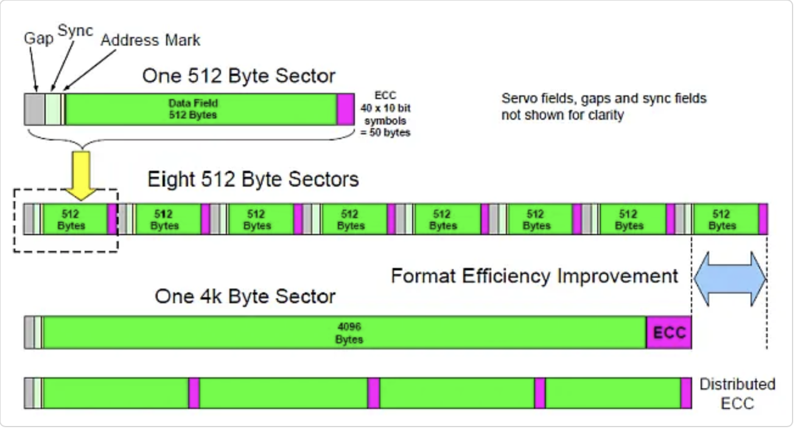

__SSD__
Что же у твердотельных накопителей (Solid-state drives)? Они используют флеш память (NAND), которая работает быстрее дисков. Но у них также есть и особенность: ссд не могут напрямую перезаписать данные на устройстве, им нужно сначала стереть память, потом записать новую.
На ssd нет понятия "сектор", тогда как осуществляются операции ввода-вывода? У ссд есть ячейки. Ячейка хранит заряд (1 бит SLC, 3 бита TLC, 4 бита QLC)

>[! SLC/TLC/QLC]
> - SLC — single level cell _(один бит)_
> - TLC — triple level cell _(три бита)_
> - QLC — quad level cell _(четыре бита)_
> - MLC — multi level cell _(исторически — 2 бита, но вообще обозначает несколько бит -- пример: память MLC (TLC)_ 

Минимальная единица чтения и записи на ссд — страница. Страница состоит из тысяч связанных ячеек. Размеры страницы обычно 4/8/16 Кб пользовательских данных. 
Стирание происходит на "erase block". Блок стирания — минимальная единица стирания, объединяющая сотни страниц на 4-64+ Мб (128-512 страниц). Такие ограничения связаны с физическим устройством памяти — запись бита (допустим из 1 в 0) можно сделать точечно. Для обратного перевода (из 0 в 1) требуется подача высокого напряжения, которое не может воздействовать на 1 страницу.

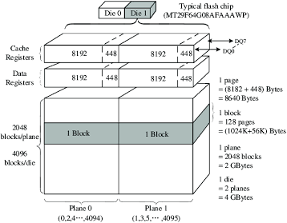


Как это работает?
При поступлении новой информации диск просто записывает её на свободные страницы. При удалении/изменении информации диск помечает страницы как недействительные. Когда свободные блоки заканчиваются, контроллер берёт блок, где накопилось много недействительных страниц, копирует оттуда оставшиеся живые страницы, старый блок стирает.

Но как тогда ОС видит память SSD устройств?
Прошивка диска FTL (Flash Translation Layer) переводит адреса LBA и переводит их на страницы. По сути FTL эмулирует для ОС привычный массив секторов.

### Разделы (Partitions)
Раздел диска — обычная разметка его секторов. В одной области вы храните одну файловую систему, в другой — другую (в конце концов swap это тоже раздел). Сами разделы изолированы, поэтому если один ваш раздел пострадает, другой останется цел.
Но как эти разделы хранятся?

Таблица разделов — специальная структура данных, хранящаяся в самом начале диска*, описывающая его разделы.
Основными таблицами разделов диска считаются __MBR__ и __GPT__ 

\* GPT хранит свою копию еще и в конце диска, для сохранности

---
__MBR__ (Master Boot Record)
Таблица разделов прямиком из 1983 года. Вся информация о разметке и загрузке физически утрамбована в "нулевой сектор" (LBA 0) размером ровно 512 байт.

- 0-445 байт: Bootstrap code — код начального загрузчика (пример GRUB - stage 1)
- 446-509 (64 байт): таблица разделов. На описание раздела 16 байт. Поэтому помещается 4 основных (primary) раздела (или 3 основных и 1 расширенный)
- 510-511 (2 байта): сигнатура загрузочного сектора

>[! tip] Extended Partition
>Расширенный раздел таблицы MBR был придуман, чтобы обойти ограничение в 4 раздела. В расширенный раздел можно включать так называемые "логические разделы". 

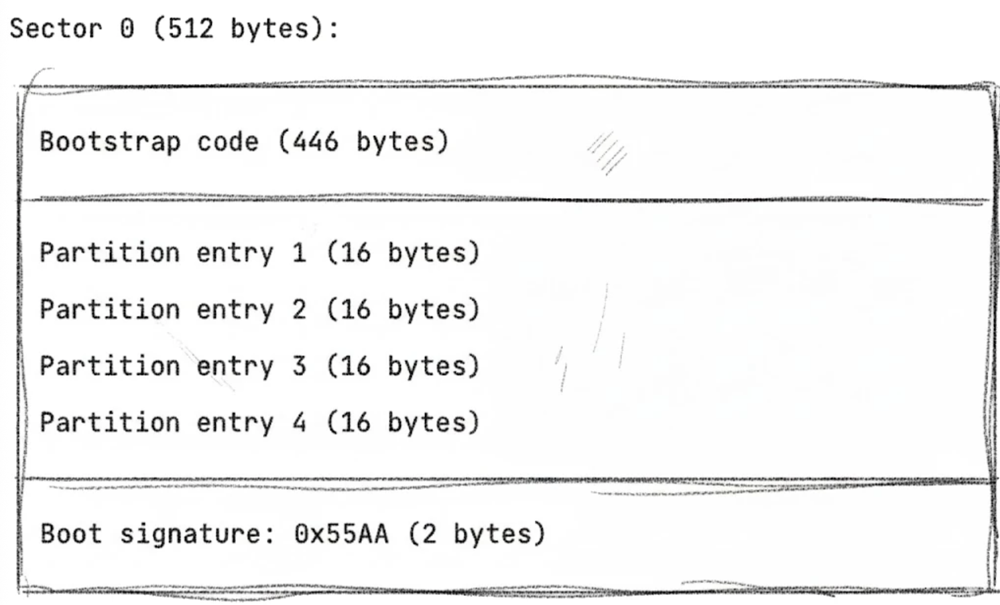

Главный минус MBR — поддержка дисков до 2 ТБ. Откуда это число?
В 16 байтном описании каждого раздела есть 32 бита на начальный номер сектора раздела и 32 бита на длину раздела в секторах. Они и создают ограничение на описание возможных секторов
```text
2^32 * 512 байт ~ 2 ТБ
```

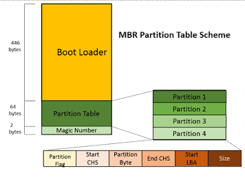

---

__GPT__ (GUID Partition Table)
Современный стандарт разметки, пришедший на смену MBR вместе с UEFI. Больше никаких тесных 512 байт на всё про всё: таблица разделов хранится не в одном секторе, а занимает целые блоки метаданных — причём как в начале диска, так и в самом конце.  
Как физически устроена разметка GPT на секторах:  

- LBA 0 — Protective MBR («защитный» MBR): чтобы старые утилиты, не знающие про GPT, не посчитали диск абсолютно пустым и не затерли разметку, в нулевой сектор записывается фиктивный MBR с одним разделом типа `0xEE` на весь диск. Для старых программ диск выглядит просто как «занятый неизвестный накопитель».  
- LBA 1 — GPT Header (заголовок): содержит размер и границы диска, уникальный GUID накопителя, указатель на саму таблицу разделов и CRC32-контрольные суммы (заголовка и записей разделов) для мгновенного выявления битых данных.  
- LBA 2–33 — Partition Entries (таблица разделов): список описания разделов. Каждая запись занимает уже не 16, а 128 байт (вмещает уникальный UUID раздела, тип, флаги и понятное имя раздела в UTF-16). В стандартные 32 сектора по умолчанию помещается до 128 разделов.  
- Конец диска — Backup GPT: GPT дублирует таблицу разделов и заголовок в последних секторах диска. Если первый сектор повредится, система восстановит разметку из резервной копии.

Когда вы создаёте раздел в GPT (например, через `fdisk` или `parted`), вы просто резервируете диапазон секторов: _«Секторы от 2048 до 500 000 000 отданы разделу 1»_. А уже дальше выбранная файловая система (ext4, XFS, NTFS) хозяйничает внутри этого диапазона так, как ей удобно.

## Общие концепты файловых систем

Что вообще делают файловые системы?:
1. Связывают имя файла и номера секторов
2. Управляет размещением файлов (в том числе изменяемых)
3. Хранение метадаты (datestamps, size, permissions ...)
4. Восстановление (Журналирование, CoW ...)

### Блок (Block)
У любой файловой системы есть своя единица измерения или блок (кластер в FAT терминологии). Диск мыслит секторами, но фс не работает с ними, слишком мелкие размеры. ФС группирует секторы в блоки, чаще всего размером 4096 байт (4 Кб). Итого блок — это минимальная неделимая единица дискового пространства

>[!Note] Зачем нужен сектор, когда есть блок? 
>Сектор — это язык железа, он существует на диске. Блок — это уровень абстракции файловой системы. Этот уровень необходим системе:
>-  для избежания огромной фрагментации файлов (с которой придут огромные таблицы разметки этих файлов)
>- Процессоры x86/Arm архитектуры управляют RAM страницами по 4096 байт. Чтение с диска происходит по схеме 1-в-1

### Суперблок (Superblock / Boot Sector)
Любая файловая система нуждается в отправной точке — фиксированном месте, где ОС может найти базовую информацию об ФС. Эта точка и есть супер блок (он же boot sector в виндовс терминологии).
Что именно хранится в супер блоке?:
- магическое число, определяющее тип фс
- размер блока
- кол-во блоков и инодов
- свободные блоки
- ...
>[!warning] Точка отказа
>Если затереть суперблок, ОС не сможет примонтировать раздел, даже если все файлы будут целы. Поэтому некоторые продвинутые ФС автоматически создают несколько копий суперблока

### File Metadata Structures
Любой файловой системе необходимо хранить метаданные файла. В Unix-подобных системах используются иноды __(inodes or index nodes)__. Инода содержит все метаданные о файле, исключая его имя — тип файла, размер, права, владелец, группа, временные метки итд: всё хранится тут. Имя файла же хранится отдельно в родительской директории. Такая реализация хранения позволяет создавать ссылки (hard links) на файлы. Т.е файл с другим именем будет указывать на ту же иноду с теми же данными и метаданными. (можно дать одному файлу много имён)

```text
       Каталог (директория)
 ┌────────────────┬─────────────┐
 │ Имя файла      │ Номер Inode │
 ├────────────────┼─────────────┤
 │ report.txt     │    45129    │───────┐ (Hard link 1)
 │ backup.txt     │    45129    │───────┤ (Hard link 2)
 └────────────────┴─────────────┘       │
                                        ▼
                         ┌─────────────────────────────┐
                         │      Inode #45129           │
                         ├─────────────────────────────┤
                         │ File Type: Regular file     │
                         │ Permissions: -rw-r--r--     │
                         │ Owner / Group: 1000 / 1000  │
                         │ File Size: 12 288 bytes     │
                         │ Link Count: 2               │
                         │ Timestamps: atime/mtime/ctime
                         ├─────────────────────────────┤
                         │ Указатели на блоки данных:  │
                         │  - Block 0: #1042           │───► [Блок данных #1042] (4 КБ)
                         │  - Block 1: #1043           │───► [Блок данных #1043] (4 КБ)
                         │  - Block 2: #1080           │───► [Блок данных #1080] (4 КБ)
                         └─────────────────────────────┘

```

Ещё чуток про иноду:
Размер самой иноды фиксирован (256 байт в ext4 к примеру). Внутри 256 байт не сохранишь сотни тысяч блоков для видеофайла, поэтому используются:
1. Прямые указатели (указатели на блоки)
2. Косвенные указатели (указатели на блоки с прямыми указателями)
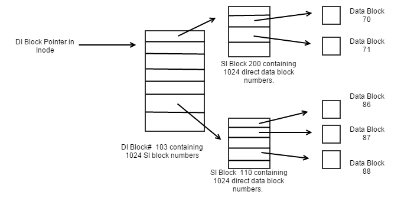
>[!warning] Кол-во инодов ограничено (Только в Ext и UFS)
>Количество инодов в системе ограничено (создаётся 1 инода на каждые 16 Кб диска). Так что если вы захотите создать миллионы крошечных файлов, место на диске останется, но закончатся иноды, вам выдаст ошибку `No space left on device` и создать новый файл будет нельзя

### Директория — что это?
Разобравшись как работают иноды можно сказать, что директория — это специальный файл, содержащий список имён файлов, указывающих на свои иноды. Помимо этого директория содержит собственную иноду ( __.__ - точку) и иноду родительской директории ( __..__ - две точки)
Гемини любезно нарисовал схему:
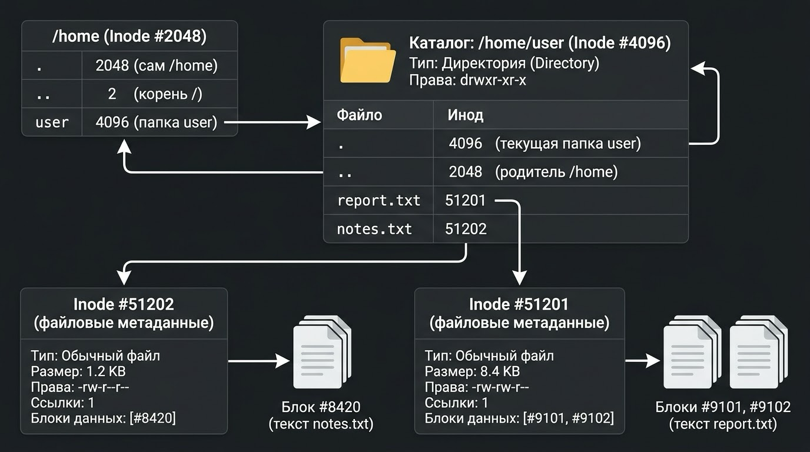

Теперь можно перейти к разбору конкретных файловых систем и их особенностях.
## FAT32
скип

## Ext4
### Файлы и директории
В Ext4 файлы и директории представлены одинаковым путём: комбинацией инодов и множеством дата блоков. Инода состоит из 256 байт, в которых:
- размер
- разрешения (права)
- временные метки
- владельцев
Директории — специальные файлы, содержащие списки сущностей, связывающих имена файлов и их инодов.

### Суперблок
Суперблок в Ext4 — это 1024 байтовая структура, записанная сразу после первых 1024 байт раздела (первые 1024 байт остаются для boot code). Фиксированная разметка позволяет точно определять где находится суперблок. 
В этом разделе хранятся данные о фс (было выше).

>[!Note] Сохранность
>Ext4 хранит бэкапы суперблоков, расположенных на диске в разных местах.

### Архитектура: Группы блоков, Дескрипторы групп, Таблица инодов, Блоки данных
Вместо того, чтобы управлять блоками, ext4 создаёт группы блоков — структуры, управляющие +- 128 Мб диска (32768 блоков по 4 Кб). 
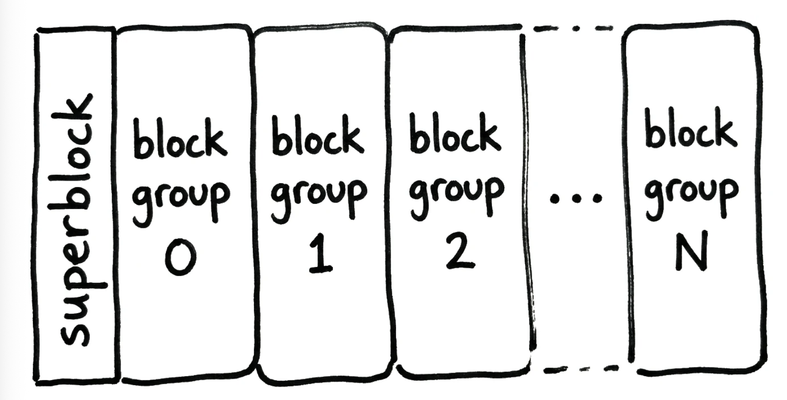

Смысл в том, чтобы располагать иноду файла и его дата блок (который маленький) в одной блочной группе. Это нужно для быстроты чтения:
- на HDD расположение иноды файла и его данных выигрывает время в поиске информации (не нужно ждать другого конца диска)
- на SSD повышает эффективность пользования кэшем
---

__Анатомия группы блоков?__
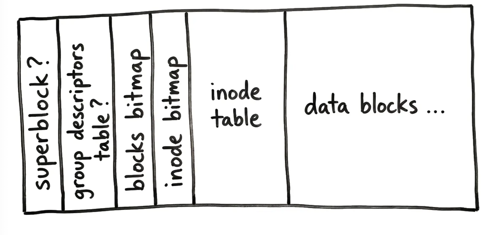

в блоке групп содержится:
- суперблок (те самые для бэкапа, не везде)
- таблица дескрипторов (не везде)
- Blocks bitmap (битовая карта блоков — отслеживает состояние блоков данных)
- inode bitmap (то же, что и с битовой картой)
- Таблица инодов
- Блоки данных

>[!tip] Про bitmap
>bitmap — по сути карта доступных дата блоков/инодов: когда нужно создать файл ОС нужно найти свободный инод под метаданные. Этот она инод ищет в inode bitmap. После этого, ей куда-то нужно разместить данные этого файла, тогда она ищет свободный блок данных через blocks bitmap.


---

__Дескриптор групп__
Групповой дескриптор — метка очередной группы блоков. Все эти дескрипторы хранятся в таблице групповых дескрипторов (group descriptor table), которая располагается в блок группе 0, сразу после суперблока.
Те же блоки, что дублируют суперблок содержат копию таблицы всех групповых дескрипторов.

---

__Таблица инодов__
Таблица инодов — массив, состоящий из инод. 1 inode -- 1 файл.

---
__Блоки данных__
После таблицы инодов идут блоки данных. Тут живёт контент ваших файлов. Также блоки данных могут содержать информацию из журналирования, И так далее...

---
__Flex Block Groups__
Множество групп (как правило 16), соединённых в один флекс блок. Этот блок содержит все метаданные входящих в него блоков, основные данные же хранятся отдельно.
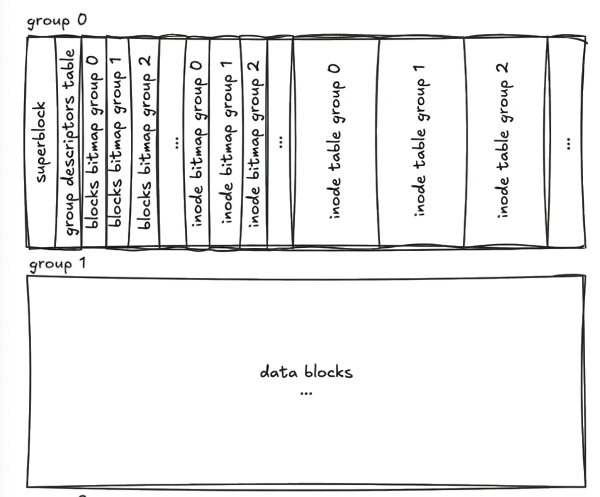

### Связь между инодами и блоками данных
Иноды связываются с блоками данных при помощи экстентов __(extents)__.
Extent описывает массив логических блоков файла (контент файла с 0 по 1000 блоки связать с физическими 50000 по 51000) с непрерывным диапазоном физических блоков на накопителе
Extent содержит:
- номер первого логического блока
- длину (в блоках)
- физический адрес блока (начало)
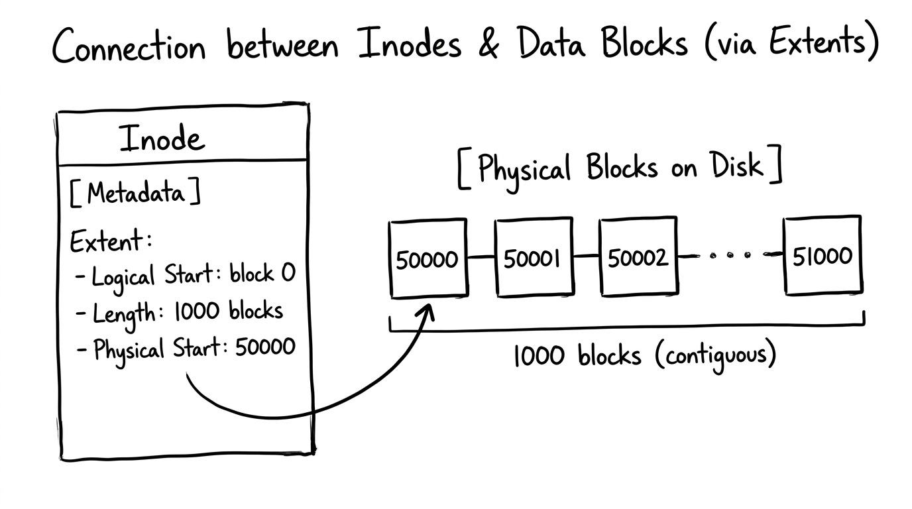


### Поиск свободного места
Когда файлу нужно больше блоков, __multiblock allocator__ пытается найти блоки, физически расположенные рядом. Чтобы было проще ext4 использует __предварительное выделение (preallocation)__ — резервирует заранее место. Помимо этого ext4 использует __отложенное выделение (delayed allocation)__ — механизм, позволяющий сначала получить информацию о полном файле, после чего выделить умное расположение файла (размещает файл в RAM, чтобы узнать о его размерах).
Для больших файлов ext4 просто пытается разместить их так близко, как только может.

### HTree
Когда в каталоге становится слишком много файлов, обычный линейный поиск начинает сильно тормозить. Для решения этой проблемы Ext4 использует HTree —специальное дерево, построенное на хэшах имён файлов.  
Вместо того чтобы читать все блоки каталога по очереди, ОС берёт имя файла, который вы ищете, хэширует его и по этому хэшу моментально находит нужный блок данных.
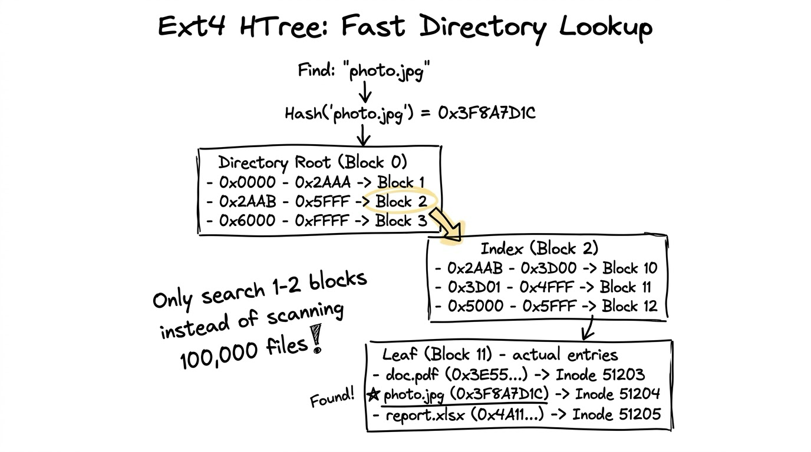
### Журналирование
Если питание выключится на моменте записи файла на диск, на диске появится "мусорная" инода. Как с этим бороться?
До изменения файлов на диске ОС записывает все планируемые изменения в журнал. Загрузка файла идет постепенно, каждый этап проходит коммит. Все незакоммиченные изменения отбрасываются, в то время как закоммиченные накатываются на фс при повторном монтировании.
Изначально на ext4 включено только журналирование метаданных, но эту настройку можно изменить

### Про семейство Ext
| ФС   | Главная фича                       | Лимит раздела | Где живёт сейчас                                |
| ---- | ---------------------------------- | ------------- | ----------------------------------------------- |
| ext2 | Без журнала (базовые иноды)        | 16 ТБ         | Роутеры, старые флешки, /boot без износа ячеек  |
| ext3 | Появился журнал (защита от крашей) | 16 ТБ         | Древние серверы (legacy Linux)                  |
| ext4 | Экстенты, HTree, наносекунды       | 1 ЭБ          | Стандарт в Linux (Debian, Ubuntu), Android, NAS |

### Итог
Подводя итог можно сказать, что ext фс, используемая поколениями юзеров линукс. Надёжная и простая фс.

## XFS
XFS — файловая система, спроектрированная в 1993 для больших накопителей (в то время измеряла диски в терабайтах, в то время как остальные в гигабайтах).
Главная идея — разбить диск на независимые зоны — __Allocated Groups__, каждая из которых имеет своё отслеживание свободного места, управление инодами итд. Такая архитектура позволяет масштабировать фс вплоть до 8 эксабайт. 
Для этого фс использует __B+ trees__ (для свободного места, инодов, экстентов ...)

### Allocated Groups
Фс разбивает диск на Allocated Groups (AGs). Каждая такая AG это мини файловая система. Каждая AG начинается с 4 заголовков метадаты:
- superblock (block size, AG count, UUID, root dir inode ...)
- AGF (AG Free space header) — отслеживает свободное место
- AGI (AG Inode header) — управляет инодами
- AGFL (AG Free List) — зарезервированные блоки для метаданных самой группы

>[!Note]
>Важно понимать, что B+ tree, которое управляет данными AGs располагается именно в этих заголовках
>(B+ Tree будет рассмотрена дальше)


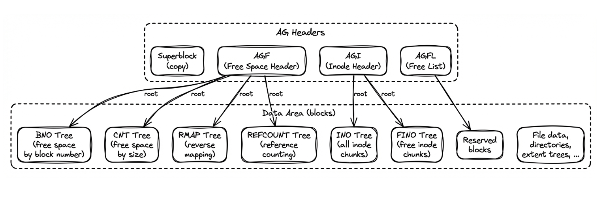
Независимость AGs важна потому что именно из-за неё XFS может уходить в параллельность. (файл А пойдет в AG0, файл B в AG1)

Все эти группы находятся на диске последовательно. 
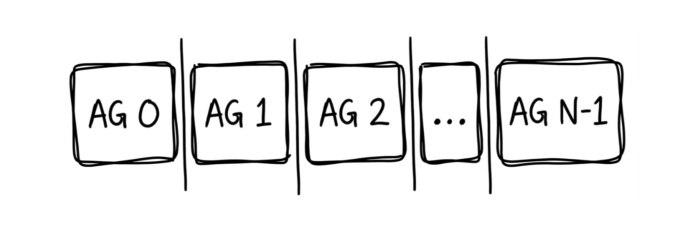
D отличие от многих других файловых систем (FAT или ext4), которые резервируют начальные секторы раздела под машинный код загрузчика ОС (Boot Sector), XFS этого не делает. Раздел сразу начинается с AG 0, а AG 0 с нулевого байта начинается прямо с Суперблока.
### B+ Trees: Free Space, Inodes

__Кротко про B деревья__
B+ дерево — сбалансированное многолучевое дерево поиска, оптимизированное для работы с блочными накопителями. Содержит:
- Внутренние узлы (ветви) — хранят указатели на дочерние узлы
- Листья — содержат сами данные

Все листья на нижнем уровне связаны двусвязным списком (для диапазонных запросов не нужно перемещаться наверх и снова вниз, можно бежать вправо или влево). Дистанция от корня до листа одинаковая.
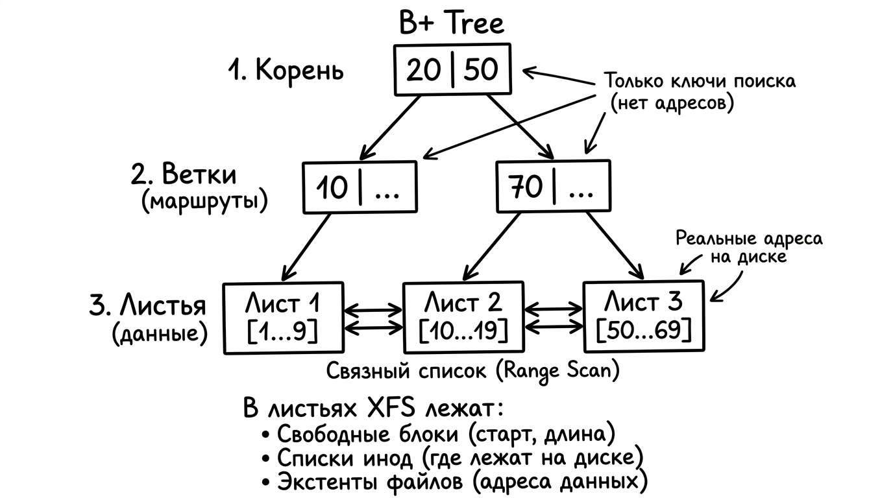 

---

__Отслеживание свободного места__
Так как всё таки используются Б деревья в XFS?
На схеме заголовков AG видно, что AGF использует 2 дерева:
- BNO tree — сортирует свободные экстенты по номеру блока
- CNT tree — сортирует экстенты оп размеру блока

>[!Note] А зачем 2? 
>XFS использует 3 стратегии аллоцироваиния места на диске:
>- __Exact__ -- когда нужен непрерывный массив блоков определённых номеров. BNO смотрит по дереву на локацию и предоставляет адреса.
>- __Near__ -- используется, когда нужно расширить уже существующий файл. XFS ищет по 2 деревьям сразу, но обычно побеждает BNO (размещает новые данные ближе к существующим для скорости)
>- __Size__ -- используется, когда не так важно расположение файла, сколько место под него (пример: создание нового файла)

Когда выделение происходит в группе, где уже есть файлы XFS использует `near` стратегию, чтобы держать данные компактнее.
Когда происходит выделение на новом AG, XFS использует стратегию `size`

Также стоит отметить, что XFS хранит информацию об общем кол-ве свободных блоков и длину максимально большого свободного экстента. Это позволяет пропускать неподходящие AG.

---

__Работа с инодами__
Иноды располагаются в AG в чанках по 64 штуки. Для работы с ними также используется 2 дерева:
- INO -- отслеживает все чанки (где находятся на диске, какая инода в каком чанке)
- FINO _(Free INO)_ -- отслеживает все свободные чанки (которые содержат хотя бы 1 свободный слот)

### Внутри иноды
Внутри иноды всё те же метаданные, которые описывались выше, но с одним отличием. Inode в XFS имеет гибкое хранилище, которое разбито на 2 секции (2 форка):
- data fork -- содержит главный контент иноды (для файла: блоки, для ссылки: путь до цели). 3 режима: local (контент в иноде), extents (до 10 экстентов), BMBT (становится корнем дерева экстентов)
- attribute fork -- дополнительная секция, содержащая дополнительные метаданные (ACLs / кастомные теги)

>[!Warning] Необычно
>Инода занимает 512 байт. Если данных в файле очень мало, они могут храниться прямо в иноде. Когда данные расширяются, они переезжают в экстенты.

### Директории и файлы
Директория — связка между именами файлов и их инодами. Каждый вход содержит имена файлов и их иноды (+ тип файла)

Файлы хранятся в экстентах. Каждая экстента содержит логическое смещение,  номер физического первого блока и длину

Как и ext4 XFS использует delayed allocation. 

### Журналирование
XFS использует **write-ahead logging**. Суть: до записи метаданных на диск записывает в журнал. Механизм: записывает в журнал лишь изменения исходных метаданных, а не переписывает всю структуру
В XFS нельзя журналировать сами данные, в отличие от ext4

### Revers mapping
Обычно файловая система знает связь сверху вниз: _Inode_ -> _Блоки данных_. Reverse Mapping (rmapbt) добавляет обратное B+ дерево в каждой AG: оно отвечает на вопрос «Кому принадлежит вот этот конкретный физический блок на диске?».  
Зачем нужно:  
- Быстрое восстановление: если на диске повреждён блок метаданных, ФС мгновенно понимает, какой файл затронут, без полного сканирования всего терабайтного раздела.  
- Реакция на бэд-блоки (Bad Sector Recovery): контроллер диска сообщает об ошибке чтения физического сектора — XFS сразу находит файл-владелец и изолирует повреждение.  
### Reflink
Поддержка клонирования файлов по принципу Copy-on-Write (CoW).  
При копировании через `cp --reflink=always` XFS направляет экстенты нового файла на те же самые физические блоки оригинала и увеличивает счетчик ссылок. Физические данные не дублируются, а создание копии происходит практически мгновенно независимо от размера файла.  
Счетчики ссылок отслеживаются в отдельном B+ дереве счетчиков (refcountbt), по одному на каждую Allocation Group. Когда один из клонированных файлов модифицируется, XFS видит, что блоки являются общими (счетчик ссылок > 1), выделяет новые блоки под измененные данные и уменьшает счетчик у старых. Второй файл остается нетронутым.

### Итог

Итого XFS — сложная многогранная система. Она занимает больше 200_000 строк кода. Из-за своей сложности и структуры она потребляет больше оперативной памяти. Изначально спроектированная для серверных машин XFS может плохо себя показывать на десктопах, из-за своей сложной системы. Но если вам нужно большая база данных, работающая с массивными объёмами данных XFS это ваш выбор.
## Btrfs
Btrfs, она же BTreeFs, она же BetterFS — файловая система с радикальным подходом модификации файлов. Btrfs никогда не модифицирует данные (in place) на диске (как это принято например в ext4), каждое изменение она записывает в новое место на диске. Даже метаданные она перезаписывает в новое место, сохраняя старые записи до момента, когда всё закомиченно.
__CoW__ подход этой фс позволяет ей делать мгновенные снапшоты, а также вместе с другими технологиями: per-block checksums (self healing), subvolumes, transparent compression и другие. Обо всём по порядку

### Архитектура пула: Chunk Tree, Subvolumes
Рассматриваемые выше фс располагались на одном разделе диска (`/dev/sda1`), Btrfs использует другой подход. 
>[! Note] LVM\*
>По мнению автора (меня), технология субтомов в Btrfs и LVM очень похожи. Следует отметить, что это 2 разные технологии. Btrfs можно поставить в LV, но тогда фс будет дублировать функции LVM. 
>LVM - менеджер виртуальных блочных устройств __под__ файловой системой. У них разные архитектурные уровни

Btrfs управляет пулом устройств: Фс можно запустить на нескольких физических дисках, более того, вы можете добавлять новые физические диски позже. 
Btrfs управляет __logical address space__ -- единым потоком логических адресов, доступных на всех физических дисках, подключённых к технологии. Логические адреса объединяются в __чанки__ (1 Гб для данных, 256 для метаданных и  связываются с физическими с помощью __chunk tree__. Chunk tree может выполнять двойную роль: связывать логический адрес с 2 физическими (mirroring) или разделять физические адреса среди нескольких дисков (striping). 

__Всё__ что работает выше логического уровня работает именно на логических адресах.

На вершине логического пространства располагаются субтома — изолированные независимые деревья файловой системы, делящие общий пул пространства. Для операционной системы субтом выглядит как полноценная файловая система со своим корнем, каталогами и файлами, и монтируется стандартной командой `mount`.  
А снапшот в Btrfs — это просто субтом, который в момент создания указывает на то же самое CoW-дерево, что и оригинал.
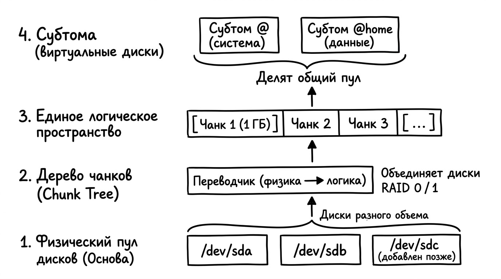

### B-tree Building Block
Файловая система btrfs основана на б-деревьях __(b-tree)__. Тут нет разных форматов для хранения разных структур: вся файловая система состоит из однотипных B-деревьев, использующих единый формат блоков по 16 Кб.

Любой такой 16 Кб блок метаданных содержит начинается с одинакового заголовка (контрольная сумма __(csum)__, глубина узла __(level)__, идентификатор дерева __(owner)__, generation (номера транзакций)) 

__Leaf nodes__ (`level = 0`)
Тут находятся сами данные (метадата). Она использует __slotted page__ layout: дескрипторы данных располагаются в начале страницы, они указывают на реальные данные, находящиеся на в конце странице. Таким образом одна страница может вмещать в себя данные разных размеров на одной странице без потери пространства.

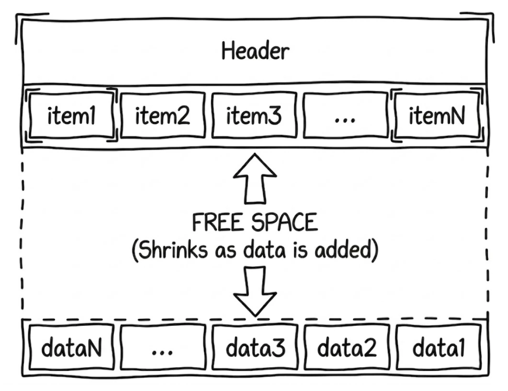
Так как дескрипторы фиксированного размера и отсортирована по ключу по ним легко искать нужную информацию.

__Internals nodes__ (`level > 0`)
Внутренний узел, содержащий:
- Ключ _(key)_ — минимальный ключ для массива указателей
- Адрес _(blockptr)_ — логический ссылка на другую ноду (например на Leaf Node)
- Поколение _(generation)_ — номер транзакции, в которой был записан дочерний блок

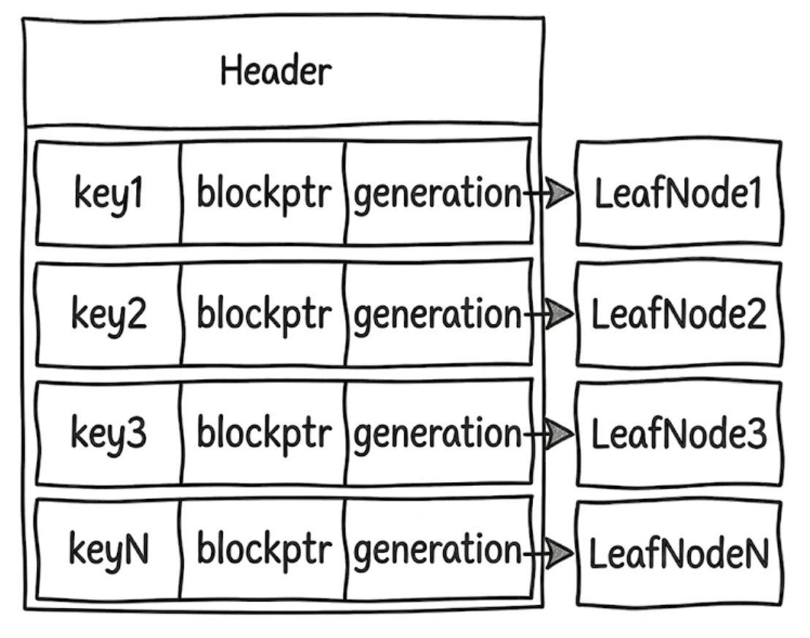
Благодаря этому механизму работают мгновенные снапшоты: фс не удаляет старые блоки
А также эта система помогает CoW.

Сами ключи состоят из 3 полей: `objectid, type, offset`
- objectid (определяет сущность файла)
- type (определяет тип сущности внутри дерева)
- offset (хранится самая разная информация в зависимости от типа)

### Superblock
В отличие от ext4 (где супер блок расположен после 1024 байтного зазора) и xfs (где он лежит в AG0) Btrfs пишет свой суперблок на 64 KB, 64 MB, и 256 GB на устройстве.
Суперблок содержит обычную информацию. filesystem UUID содержится на каждом диске в пуле (одинаковый). Так фс понимает, какой диск содержится в пуле.

### Root Tree
Root Tree — мета-дерево, которое хранит указатели на корни всех остальных деревьев фс.

Чтобы получить адрес root tree в суперблоке должен быть логический адрес (который из физического)
поэтому суперблок напрямую подключён к chunk tree
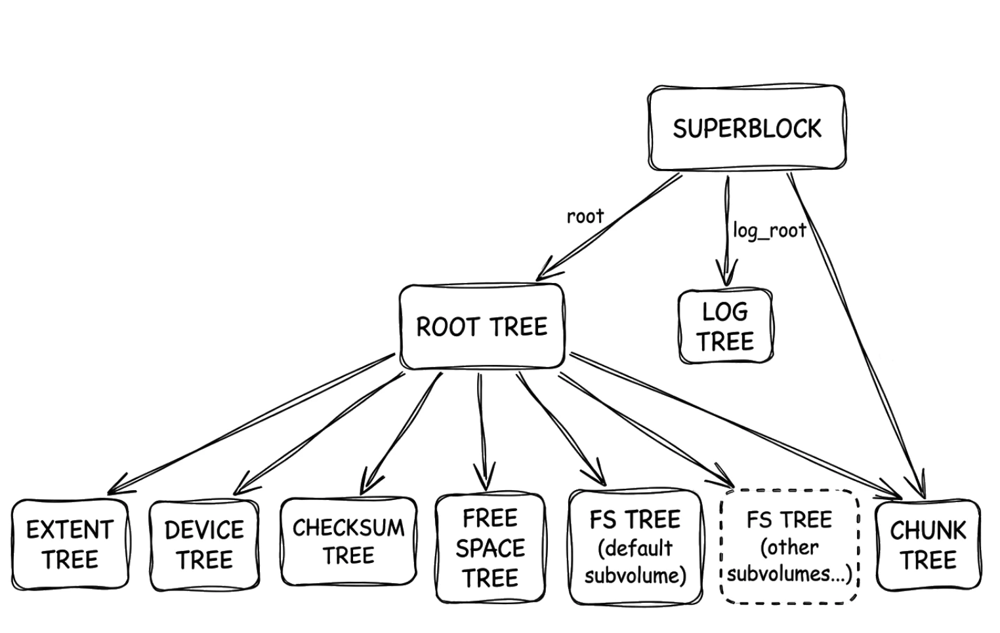

### FS Trees
Каждый субтом имеет своё дерево, в каждом таком дереве и живут данные (опять же: метаданные. Все экстенты с реальными данными файлов хранятся вне деревьев). Это крутой плюс: инода файла, его хардлинк и ссылки на экстенты — всё будет хранится на одном дереве. 

В ключе:
- Иноды помечаются как: `(inode_number, INODE_ITEM, 0)`
- Файлы помечаются как: `(inode_number, EXTENT_DATA, byte_offset_in_file)`
- Директории помечаются как: `(dir_inode, DIR_ITEM, hash_of_filename)`

### Free space: Extent Tree
Если Fs tree отвечает на вопрос: "какие экстенты принадлежат этому файлу", то __Extent Tree__ отвечает на вопрос: "Кто сейчас использует этот кусок диска и сколько у него владельцев"
В дереве хранится записи 2 типов:
- BLOCK_GROUP_ITEM -- описывают чанки
- EXTENT_ITEM / METADATA_ITEM -- описывает точечные записи о занятых блоках

При аллокации фс сначала выбирает Block group, а внутри него уже ищет свободные блоки.

### Checksum Tree
Checksum Tree -- дерево контрольных сумм. Отвечает за проверку целостности данных пользователя (Не метаданные, т.к их чексум записан в заголовке).

Внутри дерева всего один тип записей: `EXTENT_CSUM`
Алгоритм выбирается при mkfs (`CRC32c`, `XXHASH`, `SHA256`, ...)

При чтении файла btrfs вычисляет его хэш и сверяет с записью в дереве. Если хэш не совпадает ядро фиксирует ошибку. После этого btrfs забирает копию данных с зеркального диска.
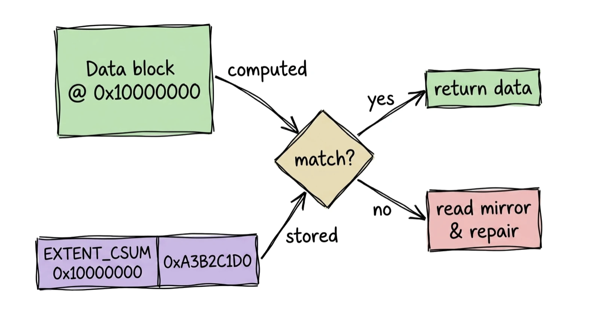


Другие деревья можете посмотреть сами. :)

### Снапшоты
Теперь мы можем чётко понять, как работают снапшоты и почему они такие быстрые. Секрет прост: создать снапшот -- значит создать новую запись корня в Root Tree, которая указывает на вершину существующего дерева.
```
Before snapshot:
  Root Tree → FS Tree 5 → [inode/dir/extent nodes...]

After snapshot:
  Root Tree → FS Tree 5   → [same inode/dir/extent nodes...]
           → FS Tree 256 → [same nodes! shared via ref count]
```

Снапшоты быстры, потому что фс не копирует файлы, а просто добавляет еще один указатель
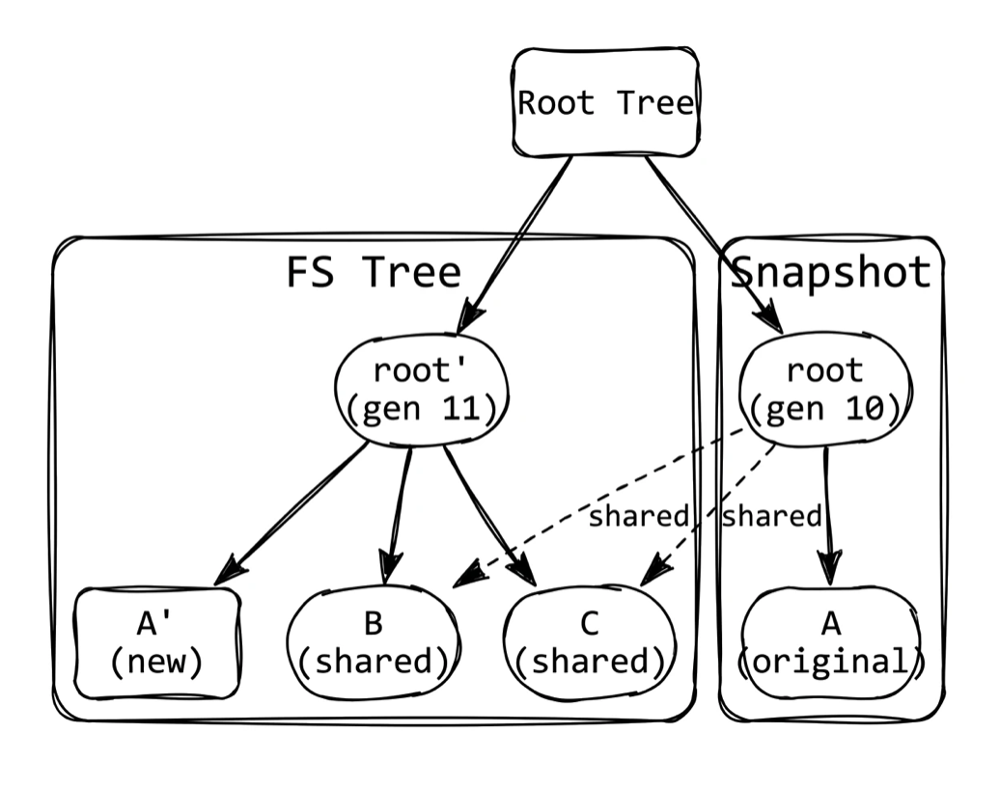

### Итог
Итого Btrfs — амбициозная и функционально перегруженная файловая система, которая стирает грань между традиционной ФС и менеджером дисковых томов. Она избавляет от необходимости возиться с LVM и аппаратным RAID, а подход Copy-on-Write вместе с повсеместными контрольными суммами даёт почти мгновенные снапшоты и надёжную защиту от тихого повреждения данных.  
Однако за эту универсальность приходится платить: постоянный CoW неизбежно приводит к сильной фрагментации диска и просадкам производительности на сценариях с частой случайной перезаписью (активные базы данных, образы виртуальных машин, торренты), а движок B-деревьев требует заметно больше ресурсов CPU и памяти.

## ZFS
Создатели Btrfs брали вдохновление у более старой системы — ZFS. Сейчас эта файловая система живёт как OpenZFS. Кажется, что ZFS решает те же проблема: CoW, Pooled Storage, snapshots, checksums... Разница в том, что вместо универсальных ключей в B-деревьях ZFS использует 128-байтовые указатели на блоки. 

### Где ZFS располагается
Как и btrfs, ZFS управляет пулом дисков (`zpool`). Внутри этого пула находятся 3 уровня:
- SPA _(Storage Pool Allocator)_ -- самый нижний уровень, который общается с дисками. Превращает физические диски в дерево виртуальных устройств _(vdevs)_ (как одиночные диски, так и рейды). Также на этом уровне есть ZIO — инструмент, проверяющий checksums, compression, encryption, allocation
- DMU _(Data Management Unit)_ -- работа заключается в том, изолировать верхние уровни от геометрии дисков. Далее для следующего уровня доступны __объекты, dnode...__ На этом уровне происходит CoW
- DSL _(Datast and Snapshot Layer)_ -- врехний уровень, собирает объекты в датасеты, которые пользователь видит в терминале.

### SPA
SPA превращает диски в то, что могут использовать другие уровни ZFS. SPA — это дерево, состоящее из физических дисков, их групп (`top-level vdevs`), объединённых в 1 пул, который будет распределять нагрузку на все группы.
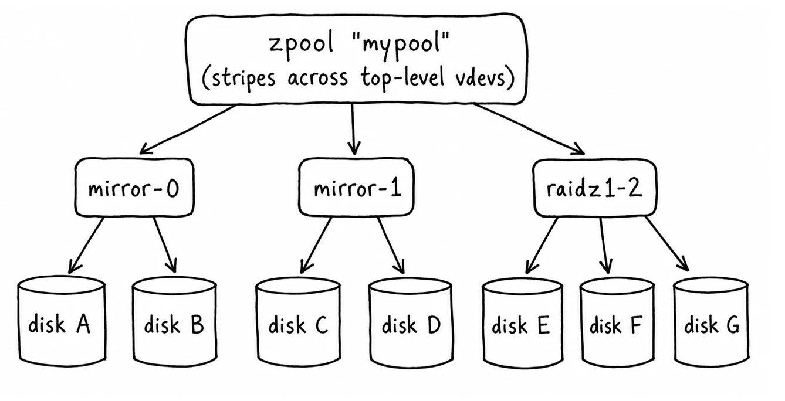

Избыточность ZFS живёт на уровне vdev, а не на уровне pool. 

### Внутри vdev
На каждом диске пула хранится 4 копии структуры, называемой __vdev label__ (2 в начале и 2 в конце диска). Каждая vdev label содержит:
- pad / boot envblock -- переменные окружения
- NVList -- содержит словарь, описывающий весь пул.
- Uberblock ring -- содержит 128 uberblocks (корень доверия - фиксирует глобальное состояние пула на момент транзакции)
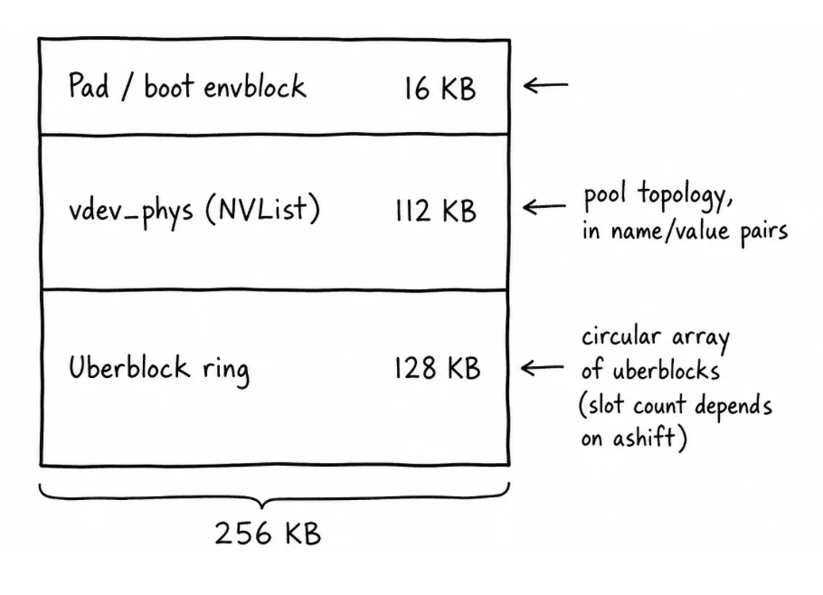

### Space management
Каждый top-level vdev разрезан на 200 metaslabs — юниты аллокации диска. Чтобы отслеживать свободные юниты используется __space map__ -- журнал аллокации/освобождения памяти. При необходимости выделить место на диске ZFS проходит по журналу и находит место. Чем больше заполнен диск, тем медленнее происходит поиск свободного места. Поэтому рекомендуют заполнять диск не больше чем на 80%.

Когда место запрошено, SPA остаётся только записывать изменения, тут выходит уберблок.
### Uberblock
При модификации файлов возникает вопрос: какое состояние всего пула является самым свежим? Именно на этот вопрос отвечает Uberblock. Он записывает все изменения. Сам уберблок содержит:
- магическое число
- checksum
- transaction group number (единица обновления -- когда происходит обновление ядро маркирует его номером, на которым и заменяется число в уберблоке. Так ZFS узнаёт новую версию)
- ub_rootbp (указатель на массив в диске, где хранится остальная информация о пуле.)

Каждые несколько секунд (или по `sync`) накопившиеся изменения сбрасываются на диски в рамках очередной TXG (коммит обновления). В самом конце транзакции новый уберблок циклически записывается в Uberblock ring во все 4 копии `vdev label` на каждом физическом диске пула. Пока уберблок не записан успешно, транзакция считается несостоявшейся, а пул остаётся в предыдущем целостном состоянии.
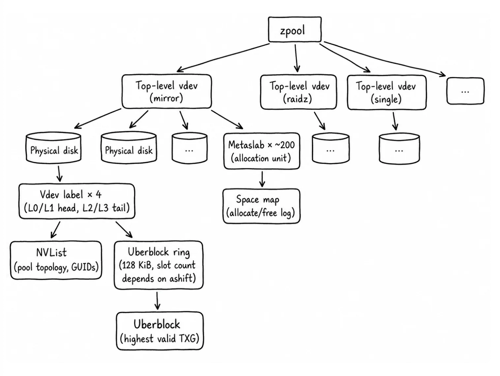
### Block pointer
Block pointer (`blkptr_t`) -- 128-байтовая структура, созданная как универсальный способ адресовать данные.
Block pointer - это не просто адрес, он содержит всё, чтобы найти блок, проверить и интерпретировать его:
- До 3 DVAs _(Data Virtual Address) -- (позволяет хранить до 3 независимых физических копий одного блока)_
- Логические и физические размеры
- Алгоритм сжатия
- Алгоритм Checksum
- 256-битная checksum
- Два `TXGs` -- когда блок был создан, когда блок был записан (позволяет быстро определить, менялся ли блок между снапшотами)
- доп поля

Так как контрольная сумма блока находится у родителя, ZFS достаточно рассчитать csum блока и сверить с родительским, чтобы проверить данные на целостность.
При обнаружении поломки ZFS идет к зеркалу или другому vdev и чинит поломку.

Каждая деталь в ZFS от метаданных до больших файлов может быть достигнута с помощью таких указателей. `ub_rootbp` в уберблоке — это корневой Block Pointer для всего дерева пула

### DMU: Dnodes, Object Sets, ZAPs
DMU существует, чтобы спрятать все инструменты SPA в единую абстракцию: каждый байт хранится и живёт в типизированном изменяемом (в плане места) CoW объекте, который идентифицируется по 64-битному номеру. Всё, что находится выше (Фс, снапшоты, тома ... — это объекты)

---
__Dnodes__ 
512-байтная запись, описывающая каждый объект. В какой-то степени эквивалент inode. Dnode содержит:
- тип объекта
- массив block pointers (как в XFS/Btrfs: если объект мал, может хранить его в себе)
- буфер (до 320 байт, может хранить uid, guid, link count etc...)

---
__Object Sets__
object set — это DMU контейнер для хранения наборов днодов. Это плоская, пронумерованная коллекция из объектов, разделяющая один корень.
Корень — это компактная структура (`objset_phys_t`) внутри которой лежит dnode объекта 0 __(meta dnode)__. 
Данные мета днода — это массив днодов для всего остального набора. Ключевое свойство заключается в том, что весь объект доступен через один блочный указатель. (чтобы обратиться к объекту 17 ZFS просто обращается к 17 слоту данных мета-днода)

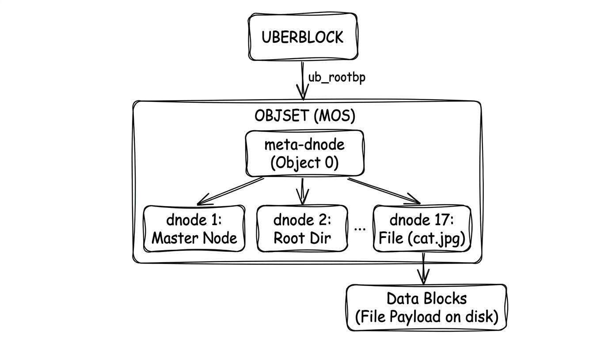

В ZFS всё сводится к Object Set:
- MOS (Meta Object Set) - системный каталог всего пула
- Датасеты - пользовательские Object Sets
- Снапшоты - независимые Object Sets

Для поиска по строковым именам — файлам, папкам и свойствам — поверх объектов DMU используется механизм ZAP

---
__ZAPs__
Третий строительный блок слоя DMU — __ZFS Attribute Processor__ (ZAP) — универсальный объектный тип данных формата "ключ/значение" на основе хэш таблицы, который ZFS использует для любого поиска вида "имя -> значение".
Записи в директориях связывают имена файлов с номерами объектов. Свойства пула связывают названия параметорв с их значаениями. Каталог объектов в составе MOS связывает системные настройки с номерами объектов.

ZAP есть 2 разновидностей:
- microZAP: для объектов малых размеров. (когда объект вмещается в один блок диска, длина имён ключей ограничена 50 символами, значения 64-битные числа)
- fatZAP: для объектов больших размеров.

Поэтому нет отдельных структур для файлов/директорий. Это всё один объект с разными ZAP. Весь DMU уровень:
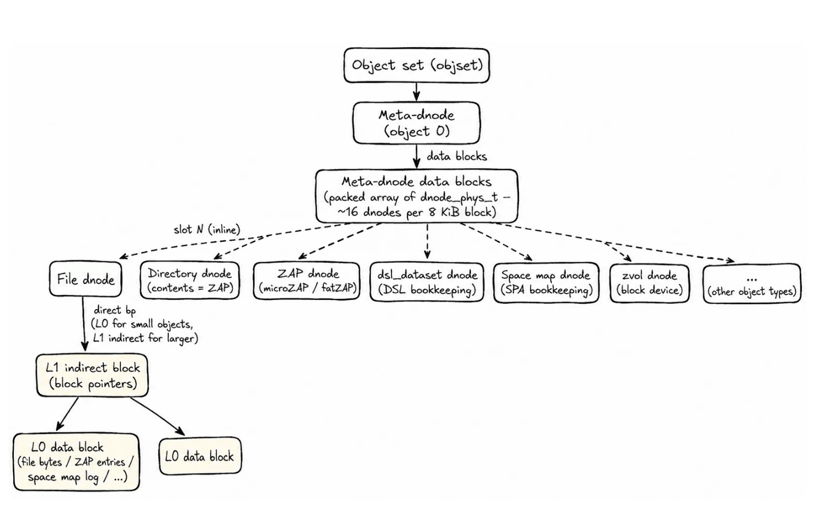

### DSL: Datasets, Snapshots, Namespace
DSL — это верхний уровень стека ZFS. Всё, что видит юзер расположено тут. 

---
__The Meta Object Set__ 
Любой уберблок на SPA уровне содержит блочный указатель (`ub_rootbp`). Переход по нему позволяет ZFS получить доступ ко всему пулу. Этот указатель находится внутри активного уберблока в кольце уберблоков каждого vdev и указывает на набор объектов, называемый MOS (Meta ObjectSet) — индекс для всего остального в пуле. Датасеты, снапшоты, конфигурация пула итд — все 
эти объекты живут в MOS.

Прочитав MOS фс идет в компактный ZAP, называемым __object directory__, там хранится вся информация, которая есть в MOS.
```
"root_dataset"   → object N1   (the DSL_DIR for the pool root)
"config"         → object N2   (the on-disk pool config)
"free_bpobj"        → object N3   (deferred frees)
"features_for_read" → object N4
"features_for_write"→ object N5
```
(object directory по сути является интерфейсем MOS)
Так выглядит весь DSL уровень:
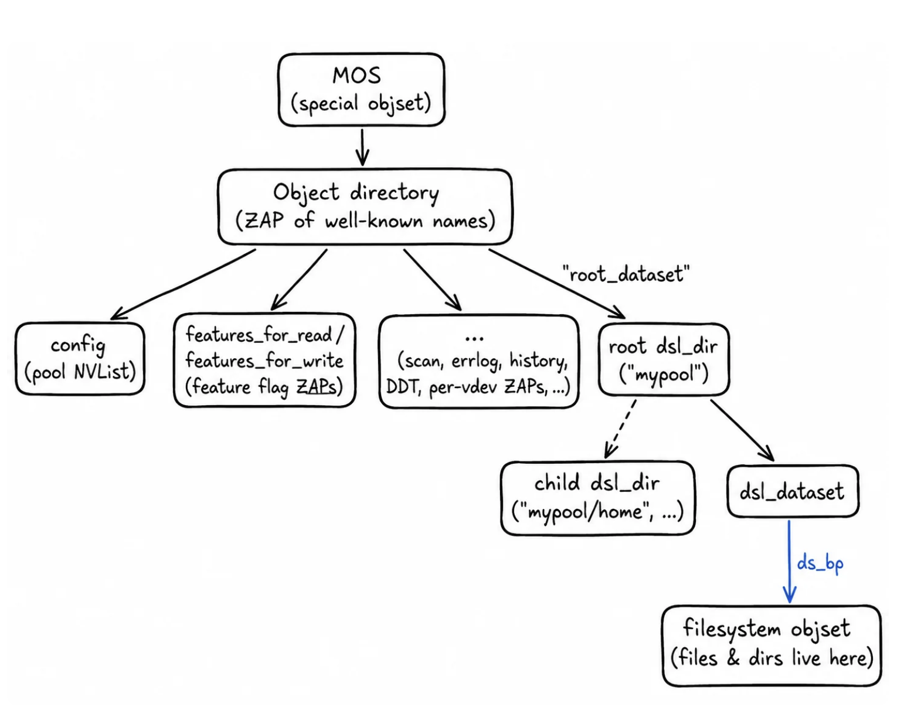

### ARC & ZIL
__ARC__
(Adaptive Replacement Cache) — технология кэширования информации в оперативной памяти, балансирующий между двумя метриками:
- MRU _(Most Recently Used)_
- MFU _(Most Frequently Used)_

Ghost Lists (списки-призраки) хранят только заголовки недавно вытесненных из памяти блоков. Когда происходит промах кэша ZFS:
- Увеличивает долю RAM под MRU (если блок найден в списке MRU)
- Увеличивает долю RAM под MFU (если блок найден в списке MFU)

---
__ZIL__
(ZFS Intent Log) — решение проблемы синхронной записи. ZFS коммитит группы транзакций (`TXG`) примерно каждые 5 секунд -- это отлично подходит для общей пропускной способности, но ужасно для приложения, использующего `fsync()`.

Когда поступает вызов `fsync()` ZFS фиксирует запись о намерении (intent log) в ZIL (на диск) и моментально сообщает об успехе. На самом деле эти данные остаются в оперативной памяти и отправляются со следующим `TXG`. Если система аварийно завершит работу до отправки `TXG`, то при первом монтировании датасета после импорта пула журнал ZIL воспроизводится, накатывая незавершённые операции.

### Snapshots
Снапшоты ZFS ещё дешевле, чем в Btrfs, как это работает?:
DSL аллоцирует новый объект, копирует текущий корневой блочный указатель датасета в объект и фиксирует его в журнале транзакций TXG.  Никакие блоки данных не дублируются. Снапшот просто замораживает ссылку на корень существующего дерева блоков.

Снапшот доступен только read-only

благодаря TXG ZFS быстро находит разницу между текущим состоянием системы и снапшотом.
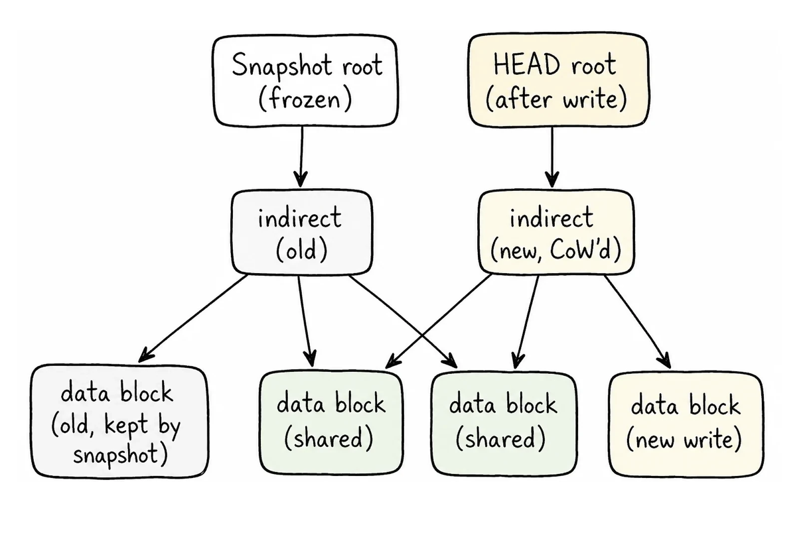
Старые блоки (серые) будут жить в `deadlist`, пока снапшот не будет уничтожен.
### Итог
Главная сила ZFS — абсолютное доверие к данным и предсказуемость состояния:  

- Дерево Меркла на базе 128-байтовых указателей (blkptr_t) полностью исключает «тихую» деградацию накопителей (bit rot), проверяя целостность сверху вниз и восстанавливая повреждения на лету.  
- Copy-on-Write в связке с кольцом уберблоков гарантирует, что файловая система всегда находится в консистентном состоянии: пул либо фиксирует транзакцию целиком, либо остаётся на предыдущем валидном шаге.  
- Универсальные структуры (Object Sets и ZAP) избавляют систему от зоопарка разных форматов метаданных, сводя всё — от директорий и датасетов до внутренних списков пула (MOS) — к однотипным объектам и хэш-таблицам.  
- ARC и ZIL решают дилемму компромисса между пропускной способностью и задержкой: первый адаптирует оперативную память под реальный профиль чтения через списки-призраки, а второй страхует тяжелые синхронные записи (`fsync`) от пятисекундных ожиданий коммита транзакций.  

В итоге ZFS жертвует простотой интеграции и легковесностью ради одной фундаментальной цели: гарантировать целостность петабайт данных под любой нагрузкой, делая создание снимков, репликацию и восстановление после сбоев атомарными и алгоритмически дешёвыми операциями.

## tmpfs
Tmpfs (Temporary File System) — специализированная файловая система ядра Linux, хранящая данные и метаданные исключительно в виртуальной памяти (страничном кэше — Page Cache). Она не опирается на физические блочные устройства: при размонтировании или перезагрузке все данные безвозвратно уничтожаются.

### Tmpfs vs Ramfs
- ramfs: предельно примитивный механизм над Page Cache. Не имеет механизма квот или ограничений размера: если процесс непрерывно пишет в `ramfs`, он сожрёт 100% оперативной памяти и вызовет Kernel Panic/OOM. Не умеет выгружать страницы в swap-пространство.
- tmpfs: полноценная виртуальная файловая система (минует блочный уровень). Динамически расширяется и сжимается под текущий объём файлов, поддерживает жесткие лимиты размера, сброс холодных страниц в swap и работу с квотами.

### Механизм аллокации и управление памятью  
- Отображение ресурсов: страницы tmpfs не дублируются на диск; в выводе ядра они маркируются как Shmem (`/proc/meminfo`) и учитываются в поле Shared утилиты `free(1)`. Реальное использование отслеживается через `df(1)` и `du(1)`.  
- Вытеснение в Swap: при нехватке физической памяти страницы файлов tmpfs сбрасываются в настроенный swap-раздел на диске. Поведение можно запретить опцией `noswap`.  
- Поддержка Huge Pages (THP): позволяет использовать Transparent Huge Pages (обычно блоки по 2 МБ) для снижения нагрузки на TLB-кэш процессора при активном чтении/записи больших файлов:  
    `huge=never` — стандартный режим (страницы по 4 КБ).  
    `huge=always` — постоянная попытка выделить 2-МБ страницу.  
    `huge=within_size` — выделение huge page только тогда, когда она целиком помещается в размер файла (`i_size`).  
      
    `huge=advise` — выделение строго по запросу приложения через вызов `madvise(2)`.


### Итог
Итого tmpfs — легковесная, бескомпромиссная in-memory файловая система ядра Linux, превращающая виртуальную память в высокоскоростное файловое хранилище. Она полностью исключает накладные расходы блочного уровня, планировщиков I/O и физических задержек накопителей, обеспечивая максимальный IOPS для межпроцессного взаимодействия и временных данных.

## OrangeFS
Обычная ФС (ext4, xfs) живёт на устройстве одной машины, и всё упирается в пределы этой машины: скорость одного диска, один канал, один процессор. Сетевая ФС вроде NFS выносит хранилище на сервер, но сервер остаётся **один**: десятки клиентов делят его диск и его сеть.

Параллельная ФС решает проблему иначе: файл **режется на куски**, куски лежат на **разных серверах**, а клиент читает и пишет их параллельно. Чем больше серверов, тем выше суммарная пропускная способность. Классический пример: вычислительный кластер, где сотни процессов одной программы одновременно пишут в один огромный файл.

### Словарь понятий
|Термин|Смысл|
|---|---|
|Клиент|Узел, на котором работает приложение; общается с серверами по сети|
|Сервер данных (I/O server)|Хранит содержимое файлов|
|Сервер метаданных|Хранит атрибуты, список datafile'ов и записи каталогов|
|Dataspace (объект)|Единица хранения: файл, метаданные, каталог, запись каталога, симлинк; у каждого есть свой handle|
|Handle|Уникальный идентификатор объекта в ФС; по нему любой клиент или сервер определяет, на каком сервере объект лежит|
|Bytestream|Упорядоченная последовательность байтов, обычно данные файла|
|Key/value|Набор пар «ключ-значение» у объекта, обычно метаданные|
|Metafile|Объект, представляющий логический файл: владелец, права и handle'ы его datafile'ов|
|Datafile|Объект, хранящий часть данных файла на одном сервере|
|Strip|Кусок данных файла фиксированного размера, раскладываемый по datafile'ам|
|Collection|Независимое пространство handle'ов на сервере; соответствует одной ФС (в конфиге `Name orangefs`)|
|Handle range|Диапазон handle'ов, закреплённый за сервером|
|BMI|Сетевой уровень (Buffered Message Interface)|
|Trove|Уровень хранения на сервере|
|Flow|Уровень потоковой передачи данных между точками|

### Архитектура
В кластере узлы играют роли клиента, сервера данных, сервера метаданных (сервер может быть и тем, и другим). Обязанности разделены так: клиент один раз обращается к серверу метаданных, получает список datafile'ов и дальше общается с серверами данных напрямую. Так сервер метаданных перестаёт быть узким местом.
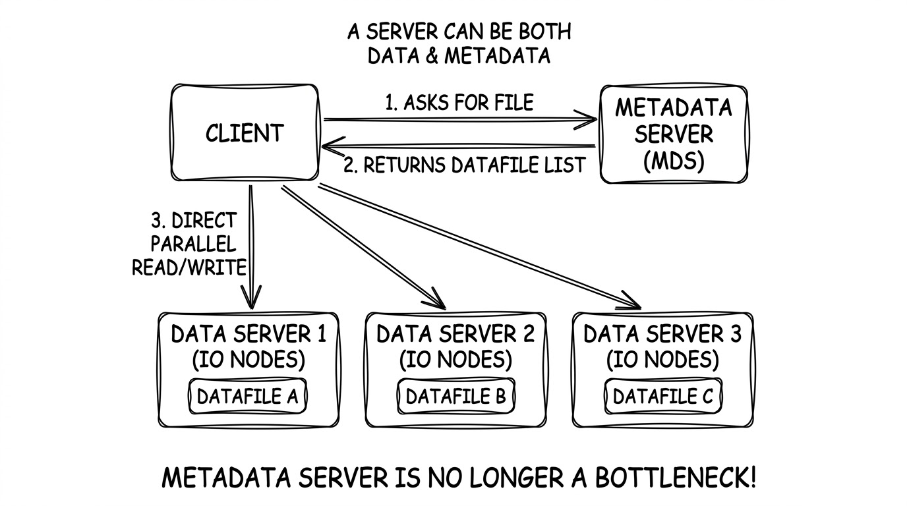

### Сервер изнутри

__Request Processor__
Главный цикл сервера принимает запросы и запускает для каждого типа запроса свой **конечный автомат**: цепочку состояний, каждое из которых выполняет C-функцию или вызывает вложенный автомат; код возврата выбирает следующее состояние. Автоматы описаны на небольшом специальном языке PVFS. Функции состояний обычно отправляют **неблокирующее задание** в слой Job (ввод-вывод в Trove или в сеть), после чего автомат «засыпает», а цикл запускает другой, и просыпается, когда задание завершится. Так сервер обслуживает много запросов одновременно, а новые виды запросов добавляются добавлением новых автоматов.

---
__Jobs__
Job даёт общий интерфейс для заданий Trove, BMI и Flow и сообщает об их завершении. Здесь же работает **планировщик запросов** (request scheduler): он помнит, какие запросы идут к каким объектам, и не допускает одновременных операций, ломающих согласованность данных одного файла.

---
__Trove: хранение__
Trove отвечает за объекты на локальном сервере. Он оперирует **коллекциями dataspace'ов**: у каждой коллекции своё пространство handle'ов, и каждая коллекция это отдельная ФС PVFS. Каждый dataspace состоит из двух частей:

- **bytestream**: байты данных, хранятся как **файл на локальной ФС** сервера;
- **набор key/value**: метаданные, атрибуты, записи каталогов, хранятся в **базе данных**
---
 __BMI: сеть__
BMI это сетевой слой, спроектированный для файловых систем: неблокирующий интерфейс сообщений с разными модулями под разные сети

---
__Flow: потоки данных__
Flow надёжно передаёт данные между двумя «концами»: память, сеть, хранилище. Он описывает политику потока (например, параллельные потоки), так что большая операция ввода-вывода идёт напрямую между сетью и хранилищем, а не через ручное копирование на каждом шаге.

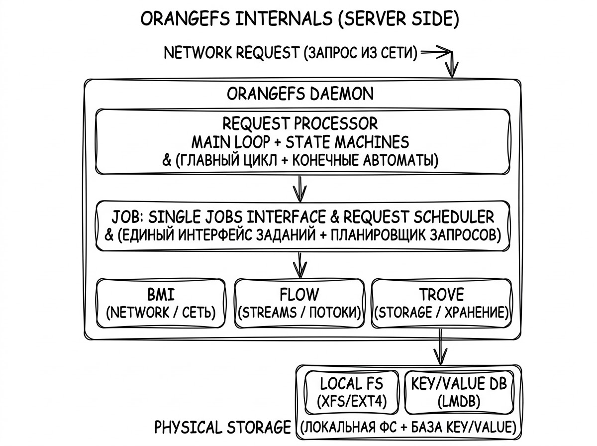


Я сильно устал, поэтому конспект ждёт своих лучших времён

## Сравнение Файловых систем
Изучив теорию, я понял, что было бы странно сравнивать эти файловые системы только по скорости, по крайней мере потому что они были спроектированы для разных целей и включают в себя разный набор функций, поэтому сравнение пройдёт по этим пунктам:
- потоковая скорость чтения/записи (с кэшем и без)
- рандомная скорость чтения/записи (с кэшем и без)
- задержки при записи (эффективность журнала)
- эффективность параллельной модификации файлов (метаданные)
- реалистичные сценарии использования 
- порча данных
- поведение при сбое

Таким образом я хочу убедится, что различия файловых систем будут существенны на десктопе.
Также хочу сформировать потребности пользователя каждой фс

Тут будет представлена настройка бенчмарков и ВМ. Сами тесты будут в практической заметке.
# Настройка ВМ
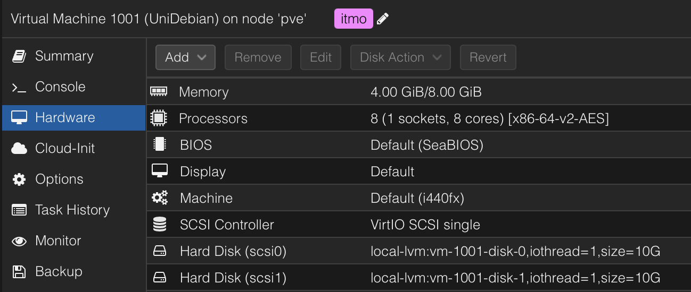

Linux Debian. 8 cores, 8 Gb Ram
# Ход работы

## Подготовка

### Посмотрим, что за система
 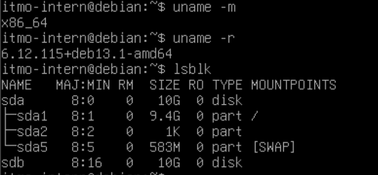

Загрузим `ZFS` на Linux Debian, т.к изначально эта файловая система не поддерживается.
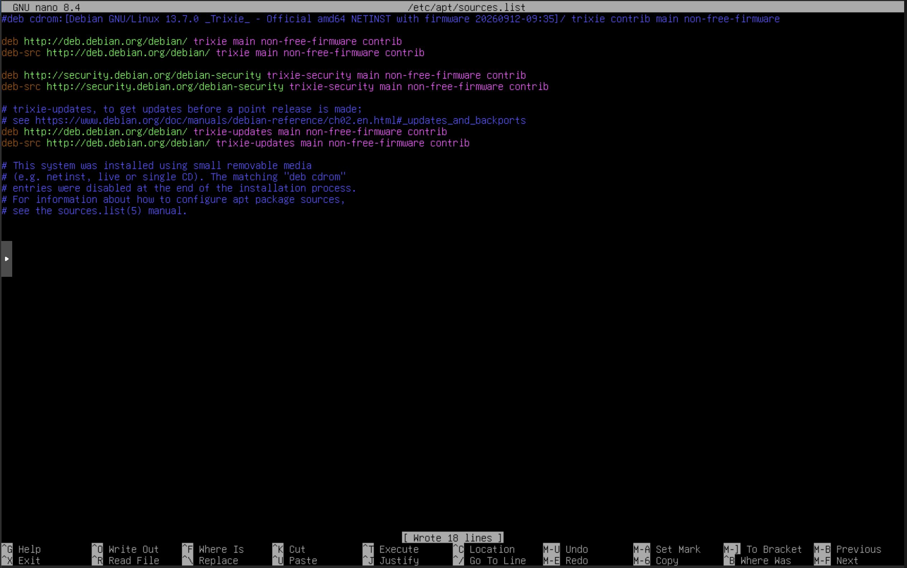

добавляем в `/etc/apt/sources.list` репозиторий `contrib`
`sudo apt update` — обновляем

```bash
sudo apt install linux-headers-$(uname -r)
sudo apt install zfs-dkms zfsutils-linux
```

Устанавливаем ZFS

Проверим, чтобы он установился 
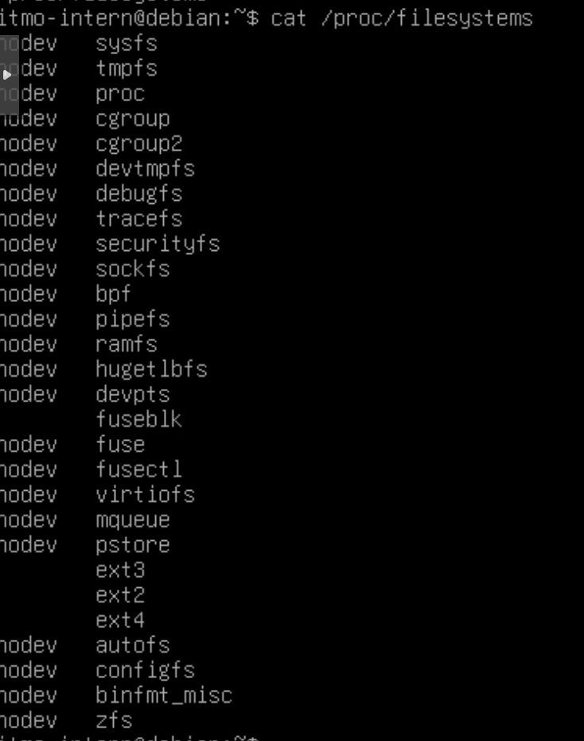

Затем загружаем модуль zfs в память:
```bash
sudo modprobe zfs
```

Теперь загрузим фс-утилиты (управление фс):
- xfsprogs (набор для xfs)
- btrfs-progs (набор для btrfs)
- e2fsprogs (набор для ext, уже есть в системе)

Загрузим утилиты для дисков:
- util-linux (было)
- dmsetup (было)
- xxd

Загрузим тесты:
- fio (скорость)
- fsmark (метадата: сколько стоит создание файла вместе с гарантией, что он дошёл до диска)
- filebench (пресеты: из исходников)

Установим пользовательскую часть Orangefs:
- pvfs2-server
- pvfs2-client-core

В документации ядра для одиночного сервера используется configure с префиксом, бэкендом базы lmdb и отключённым usrint, затем make и make install

# Источники
- [О дисках и их устройствах, а также ФС (FAT, ext4, XFS, Btrfs, ZFS)](https://internals-for-interns.com/posts/filesystems-introduction/)
- [схема физ раздела HDD](https://hetmanrecovery.com/recovery_news/how-to-recover-lost-data-from-4kn-disks.htm)
- [Схема иноды](https://loonytek.com/2015/07/11/traditional-unix-inode-block-map/)
- [tmpfs](https://docs.kernel.org/filesystems/tmpfs.html)
- Большое кол-во картинок генерировал Gemini :)


---
